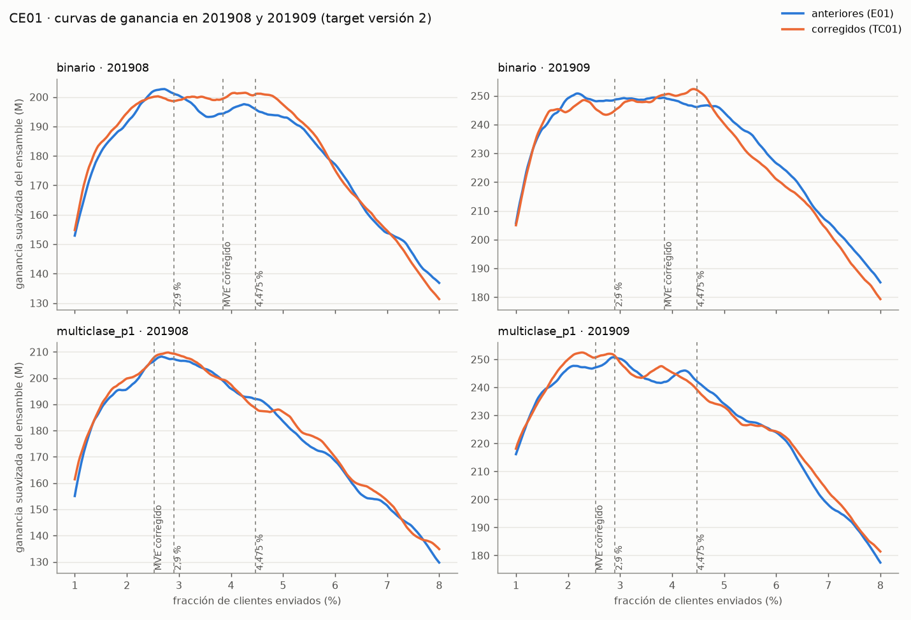
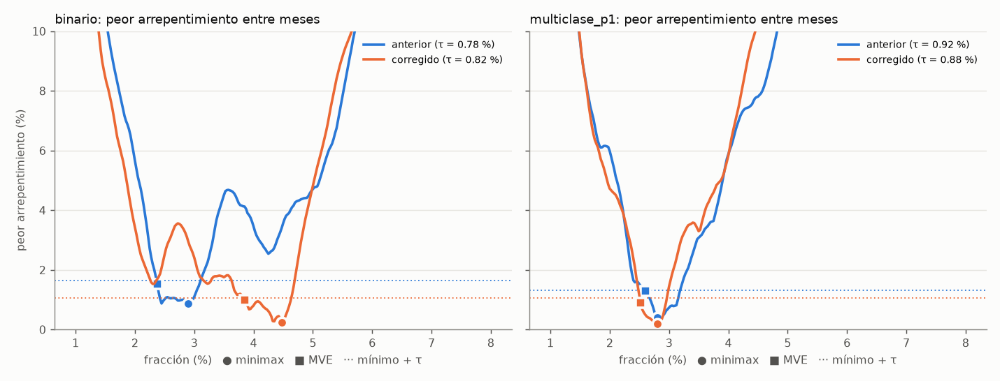
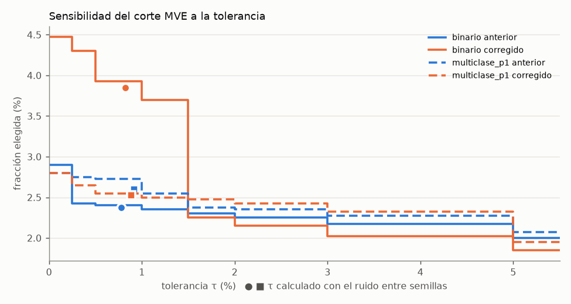
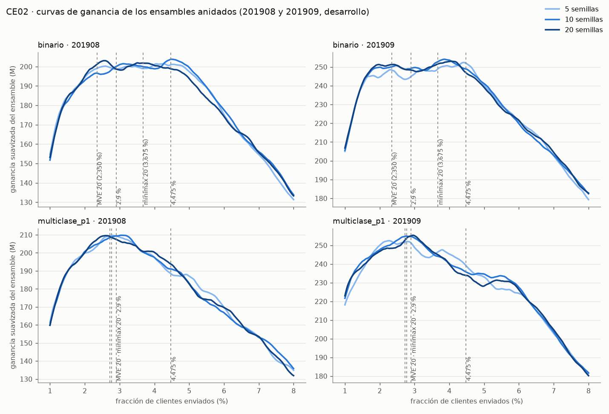
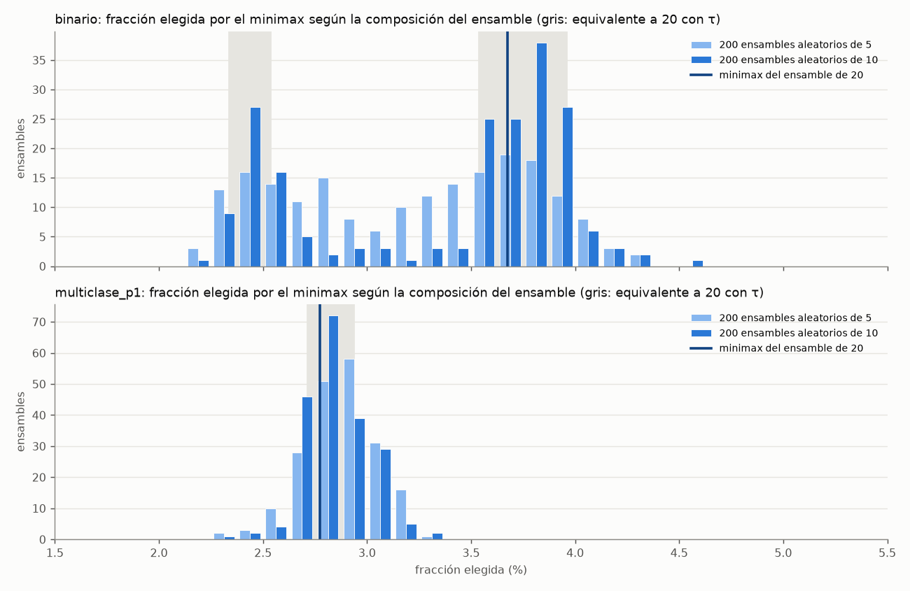
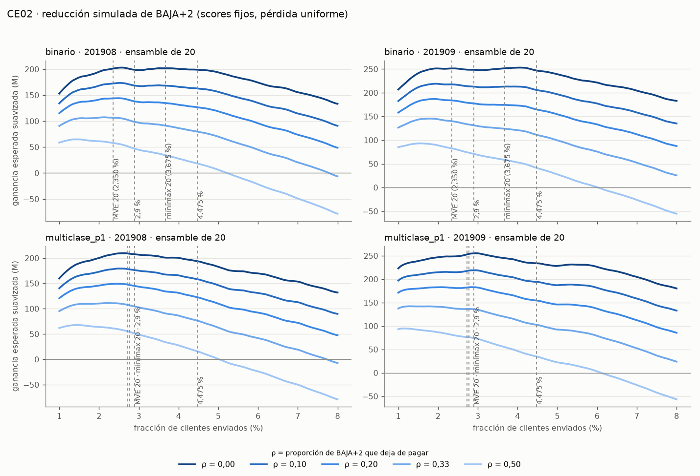

# Plan de pruebas

Actualizado el 24-nov-2026. Requisitos en `CONSIGNA.md`, ganancia en `GANANCIA.md`, propuestas en
`RELEVAMIENTO.md` § 2.5. **Todas las decisiones se toman con 201901–201912 (R1).**

## 1. Particiones y disponibilidad del target

`clase_ternaria` del mes *t* sale de la **lista de clientes** de *t+1* y *t+2*
(`entrenamiento/legado/03_construir_target.py`):

| Caso | Necesita |
|---|---|
| BAJA+1: ausente en *t+1* | lista de *t+1* |
| BAJA+2: presente en *t+1*, ausente en *t+2* | listas de *t+1* y *t+2* |
| CONTINUA: presente en *t+1* y en *t+2* | listas de *t+1* y *t+2* |

| Mes | Rol | Features (historia que usan) | Etiqueta usa la presencia en | Etiqueta con datos hasta 201912 |
|---|---|---|---|---|
| 201901–201902 | Sólo historia | 201901 sin lags; 201902 sin lag2 | 201902–201904 | Completa, no se usa |
| 201903–201906 | **Entrenamiento** | 201901–201905 | 201904–201908 | Completa |
| 201907 | **Hueco**: sólo historia para agosto/septiembre | — | 201908–201909 | Completa, **no se usa** (ver abajo) |
| 201908 | **Desarrollo** y elección de cortes | 201906–201907 | 201909–201910 | Completa |
| 201909 | **Desarrollo** y elección de cortes | 201907–201908 | 201910–201911 | Completa |
| 201910 | **Evaluación final**, una sola vez | 201908–201909 | 201911–201912 | Completa, **reservada** |
| 201911 | Pendiente | 201909–201910 | 201912–**202001** | Sólo BAJA+1 (ausentes en 201912). BAJA+2/CONTINUA necesitan 202001 |
| 201912 | Pendiente | 201910–201911 | **202001–202002** | Ninguna |

**Cuándo se conoce cada etiqueta y por qué julio no entra.** La etiqueta completa del mes *t* se
conoce recién cuando llega la lista de clientes de *t+2*:

| Etiqueta de | Se conoce completa al recibir | Disponible para predecir agosto (llega 201908)? | ¿Y septiembre (llega 201909)? |
|---|---|---|---|
| 201906 | 201908 | Sí | Sí |
| 201907 | 201909 | **No**: falta saber quién sigue en septiembre | Sí |
| 201908 | 201910 | No | No |

Dos razones para cortar el entrenamiento en 201906:
1. **Simulación de producción.** Cuando llega agosto, el último mes con etiqueta completa es
   junio. Entrenar con julio usaría información que en producción no existe todavía.
2. **Fuga hacia el desarrollo.** Una BAJA+2 de julio está presente en agosto y ausente en
   septiembre: es exactamente una BAJA+1 de agosto. Entrenar con julio le daría al modelo parte de
   la etiqueta de agosto.

En general, un mes de entrenamiento *t* sirve para evaluar el mes *d* sólo si *t + 2 ≤ d*.

**Para septiembre, cortar en 201906 es conservador.** Julio ya estaría disponible, pero se usa el
mismo modelo para los dos meses de desarrollo, para que el corte elegido entre ambos sea comparable.
Para la evaluación final en 201910 se reentrena con 201903–201908 (= 201910 − 2), como pide
Zulip 211210.

**Octubre y las listas de clientes.** Etiquetar agosto y septiembre usa las **listas** de clientes de
octubre y noviembre (sólo `numero_de_cliente`), no las features ni la etiqueta de octubre. "Reservar
octubre" significa que no se miran sus features, scores ni etiquetas hasta la evaluación final.

**Noviembre y diciembre.** La única información que completaría sus etiquetas es la presencia de
cada cliente en **202001** (noviembre) y **202001–202002** (diciembre). Esa presencia está en los
archivos de 2020, fuera del período autorizado por R1. Es la contradicción registrada en
`CONSIGNA.md` (la presentación valida en 201911 y testea en 201912). Mientras no se aclare:
noviembre y diciembre sólo aportan historia; la BAJA+1 de noviembre, que sí se puede calcular, no se
usa sola porque sesgaría la clase.

`evaluacion/particiones.py` aplica esto en código: `leer_target` rechaza cualquier mes fuera de
201903–201906 y 201908–201909, y hay una prueba unitaria que lo comprueba.

## 2. Antecedente: octubre de 2019 ya se usó

| Dónde | Uso de 201910 | ¿Se eligió algo con 201910? |
|---|---|---|
| `dmeyf-experimento-sampling` (grupo, 1 al 13-nov-2026; README y `experimentos/control/docs/hipotesis.md`) | **Test** del control y de las variantes H1–H4. Métrica G: ganancia a N\* = 3.300 envíos con los importes de la cátedra, más ΔAUC al lado. **Dos rondas evaluadas en 201910**: final 201903–201906 con 10 semillas, y final 201903–201908 con 20 semillas (la vigente, por Zulip 211210). De ahí salen los veredictos por variante (gana / no pierde / pierde, con margen δ = 2 % de la ganancia del control en 201910) y la conclusión "achicar la optimización, no el entrenamiento final". | Hiperparámetros: no (Optuna valida en 201908). Corte: no (N\* = 3.300 se fijó con el control en 201908). **Conclusiones del experimento: sí**, salen de 201910. El valor de δ también depende de 201910. |
| `C:\dev\DMEyF\experimento_sampling\06_comparar_control_h3.py` y `07_sensibilidad_muestra_h3.py` (Martín) | No leen 201910: eligen y evalúan en 201908. | No |
| `C:\dev\DMEyF\experimento_sampling\08_evaluar_ganancia_h3.py` (Martín) | Ganancia en 201910 de los modelos de 07 (control y la elección de H3 por semilla), con N = 3.300 fijo y sin reentrenar; "una sola vez por configuración", según su docstring. | Según el script, no; sus resultados forman parte de lo que el grupo vio de 201910. |
| `C:\dev\DMEyF\experimento_sampling\05` y el pipeline mensual | No leen la etiqueta de 201910. | No |
| Este repo | No leyó la etiqueta de 201910; lo garantiza `particiones.py`. | No |

**Qué no es independiente en octubre:**
- la ganancia del LightGBM de control del baseline 208135 en ese mes;
- las conclusiones sobre optimizar con una muestra (H3, H4) y sobre la ventana 201903–201908.

**Cómo evaluar respetando el antecedente:**
1. **Las decisiones salen de agosto y septiembre**: elección entre estrategias, cortes y regla de
   recomendación. Octubre no decide nada.
2. **Ninguna conclusión del experimento de sampling decide entre A, B o A+B.** Si se adopta alguna,
   por ejemplo optimizar con una muestra para ahorrar tiempo, se marca "informada por 201910
   (experimento de sampling)" y se aplica igual a todas las estrategias, para que no favorezca a
   ninguna.
3. **Protocolo congelado:** antes de leer octubre se fija en un commit con tag `protocolo-final`:
   features, objetivos, hiperparámetros, semillas, fracciones de corte, regla de recomendación y
   el script de evaluación. El script de octubre verifica ese tag y corre una sola vez.
4. **Lo que se reporta de octubre**: el ordenamiento entre A, B y A+B, la ganancia en la fracción ya
   fijada y el arrepentimiento contra el máximo de octubre. Se reporta todo, aunque contradiga a
   desarrollo. La ganancia absoluta no se compara con el control del experimento de sampling.
5. **Evidencia de transferencia sin octubre**: cada experimento mide la transferencia cruzada del
   corte (elegido en agosto y medido en septiembre, y al revés). Es la evidencia principal de
   robustez temporal; octubre la confirma o no.

## 3. Detección, alerta y tratamiento de anomalías

| Etapa | Qué hace | Estado |
|---|---|---|
| **Detección** | Regla objetiva sobre el mes que llega, sin etiquetas: columna 100 % nula; todos los observados en 0; constante no nula; cambio > 20 pp en la tasa de nulos (`politica_incidentes.json`). A agregar: PSI por variable contra la referencia de 2019, con NaN como bin aparte. | Implementada, menos PSI |
| **Alerta** | Incidente en `reporte.json` y `reporte_acumulado.csv` con variable, regla y acción. `estado_calidad = con_alertas`. No bloquea. | Implementada |
| **Tratamiento** | Cambiar el dato antes de calcular features. **Hoy no hay ninguno**: el score usa el dato tal como llega. | No implementado |

**Sustitución automática por faltante (NA): no se adopta sin prueba.**
- *A favor:* LightGBM trata NA como faltante con una dirección aprendida. Un 0 por falla de carga se
  confunde con "no tiene el producto", que es un valor con significado.
- *En contra, con evidencia propia:* en la prueba de robustez del 2-nov sobre 202001, `mcaja_ahorro`
  en 0 dejó 827 de los 1.000 seleccionados originales, y `mcaja_ahorro` en NULL dejó **800**. Para
  esa variable, NA alteró más la selección que el 0. Además, el valor sustituido entra en la
  historia y cambia los lags del mes siguiente.

**Prueba E06** (tras E01, sobre el modelo ganador; meses de desarrollo):

| Variante | Qué se hace con las columnas detectadas en el mes |
|---|---|
| O | Original, sin inyección (referencia) |
| Z | Inyección del patrón de 202006: las 47 columnas con todos los observados en 0 pasan a 0, tal como llegaría |
| N | Z con tratamiento NA: esas columnas pasan a NULL antes de calcular features |
| L | Z con tratamiento "último valor": esas columnas toman el valor del mes anterior del cliente |

- *Inyección en un mes:* inyectar en 201909, recalcular features (crudas y deltas; los lags vienen
  de la historia) y medir: ganancia a la fracción f\* de E01, coincidencia del top-f\* con O y AUC.
- *Efecto en la historia:* inyectar en 201908 y puntuar 201909. Los lags de septiembre heredan el
  tratamiento de agosto.
- *Falsos positivos de la detección:* correr la regla sobre 201901–201909 y listar cada detección
  (hay casos conocidos en 201905). Una detección en un mes normal impide automatizar el tratamiento.
- *Regla de adopción, fijada de antemano:* N o L se adoptan sólo si recuperan más ganancia que Z en
  los dos escenarios y la detección no da falsos positivos en 2019. Si no, se queda en detectar y
  alertar, y el tratamiento sigue siendo una decisión humana registrada.

## 4. Pruebas incrementales

Cada paso cambia **una** cosa respecto del de referencia. Todos comparten:
- particiones del § 1;
- ganancia de `GANANCIA.md`;
- curva suavizada con media móvil de 501;
- corte por fracción con menor arrepentimiento máximo entre 201908 y 201909;
- transferencia cruzada;
- ganancia por semilla en el corte, con media, desvío y mínimo;
- envíos, memoria y tiempos.

| Paso | Pregunta | Cambia respecto de | Estado |
|---|---|---|---|
| **E01** | ¿Binario o multiclase, con features e hiperparámetros idénticos? | — | **Ejecutada** (§ 5): no se cumple la regla; binario sigue de referencia |
| E02 | Peso de BAJA+1 en el multiclase: 0,5 contra 1 (= E01). El peso 0,25 queda fuera de esta corrida (§ 7) | E01 multiclase | **Ejecutada** (§ 8): 0,5 no se adopta; queda peso 1; el binario sigue de referencia |
| E03 | Escalado monetario por mes, antes de lags: crudo (= E01), rank con cero fijo, división por la mediana mensual | Objetivo elegido en E01 | Pendiente; requiere cambiar `features.py` en entrenamiento **y** producción |
| E04 | Combinación por rangos de binario y multiclase | Predicciones guardadas de E01, sin reentrenar | Pendiente; costo bajo |
| E05 | Lags por calendario con indicador de disponibilidad contra lags por fila | El mejor de E01–E04 | Pendiente |
| E06 | Tratamiento de anomalías (§ 3) | Modelo elegido | Pendiente |
| T01 | Tiempo de inferencia con modelos representativos | Modelos de E01 | **Ejecutada** (§ 6) |
| F01 | Evaluación final en 201910, protocolo congelado (§ 2) | Todo lo anterior | Al final, una vez |

**Regla de decisión de E01, escrita antes de ver resultados.** Gana un objetivo si cumple las tres:
1. mayor ganancia del ensamble en su propia fracción, **en los dos** meses de desarrollo;
2. la diferencia pareada por semilla tiene el mismo signo en al menos 4 de 5 semillas, en cada mes;
3. no empeora la transferencia cruzada del corte.

Si no se cumplen las tres, se mantiene **binario** como referencia, que es el objetivo del
baseline 208135. Las mismas reglas valen para E02–E05 contra su referencia.

**Parámetros fijos de las comparaciones.** No están optimizados: sirven para comparar objetivos y
features en igualdad. La optimización (Optuna según 208135, validación 201908) va después, sobre la
configuración elegida.
- lr 0,05, 63 hojas, `min_data_in_leaf` 200, `feature_fraction` 0,5, sin bagging;
- 300 rondas;
- `deterministic`;
- 5 semillas.

## 5. Resultados de E01

Corrida `ejecuciones/e01/20261124T092205_3832` (24-nov, 09:22–10:08):
- 5 semillas, 300 rondas, parámetros del § 4;
- máquina de Martín: 8 hilos, 15,7 GB, Windows 11, Python 3.12.0, LightGBM 4.7.0.

Train: 506.871 filas (CONTINUA 501.558, BAJA+1 2.717, BAJA+2 2.596). Desarrollo: 201908 con 131.775
filas (543 BAJA+2) y 201909 con 133.419 (615 BAJA+2). Octubre no se leyó.

**Ganancia en el corte elegido** (millones, ganancia **sin suavizar** en el envío número
⌈*f*·n⌉).

Cómo leer las columnas:
- **Ensamble**: ganancia del **promedio de probabilidades** de las 5 semillas, ordenado y cortado
  una sola vez. Es lo que haría el pipeline en producción.
- **Semillas: media ± desvío** y **mín–máx**: ganancia de **cada semilla sola**, cortada en el mismo
  *f* del ensamble; después, media, desvío (n − 1) y extremos de esas 5 ganancias. **No es el
  ensamble.** Mide la estabilidad entre semillas.
- *f* se eligió con la curva **suavizada del ensamble** (menor arrepentimiento máximo entre
  agosto y septiembre). Como se eligió con estos mismos dos meses, las cifras son optimistas. La
  transferencia de la tabla siguiente es la medida fuera de muestra.
- Criterios de la regla: el 1 usa la columna Ensamble; el 2 compara las semillas una por una.

| Objetivo | *f* | Mes | Envíos | Ensamble | Semillas: media ± desvío | Mín–máx semillas | AUC BAJA+2 (ensamble) |
|---|---|---|---|---|---|---|---|
| Binario | 2,900 % | 201908 | 3.822 | 202,9 | 191,9 ± 1,9 | 188,6–193,0 | 0,9105 |
| | | 201909 | 3.870 | 250,0 | 243,6 ± 5,8 | 233,5–247,8 | 0,9092 |
| Multiclase, P(BAJA+2) | 2,800 % | 201908 | 3.690 | **208,7** | 196,8 ± 3,1 | 192,2–199,9 | 0,9061 |
| | | 201909 | 3.736 | **250,4** | 241,6 ± 4,2 | 237,2–248,2 | 0,9067 |
| Multiclase, P(B1)+P(B2) (diagnóstico) | 3,950 % | 201908 | 5.206 | 198,9 | 191,5 ± 7,1 | 182,4–200,0 | 0,9072 |
| | | 201909 | 5.271 | 247,7 | 244,2 ± 4,7 | 240,0–251,0 | 0,9081 |

**Transferencia del corte** (sobre el ensamble: *f* elegido con la curva suavizada de un mes y
aplicado al otro; arrepentimiento = pérdida relativa al máximo suavizado del mes medido):

| Objetivo | 201908 → 201909 | 201909 → 201908 | Peor caso |
|---|---|---|---|
| Binario | 2,725 % · 248,7 M · 1,0 % | 2,175 % · 196,2 M · 3,8 % | 3,8 % |
| Multiclase | 2,675 % · 250,6 M · 1,0 % | 2,850 % · 206,9 M · 0,5 % | **1,0 %** |
| Multiclase B1+B2 | 2,525 % · 244,0 M · 2,2 % | 4,250 % · 192,5 M · 3,1 % | 3,1 % |

**Comparación pareada por semilla** (multiclase − binario, cada uno en su *f*):
- 201908: +6,9, +4,7, +5,8, +8,0 y −0,8 M ⇒ 4 de 5 a favor del multiclase.
- 201909: −1,8, +0,4, +5,9, −5,1 y −9,5 M ⇒ 2 de 5.

**Decisión según la regla fijada antes de correr:**

| Criterio | ¿Se cumple? |
|---|---|
| 1. Mayor ganancia del ensamble en los dos meses | Sí: +5,8 M en agosto, +0,4 M en septiembre |
| 2. Mismo signo en ≥ 4 de 5 semillas en cada mes | Agosto sí; **septiembre no (2 de 5)** |
| 3. No empeora la transferencia | Sí: peor caso 1,0 % contra 3,8 % |

⇒ **No se cumple la regla: el binario sigue como referencia.** El multiclase queda como candidato con
señal a favor en agosto y en la transferencia del corte, y empate en septiembre. E02 (peso de BAJA+1)
parte del multiclase de E01.

**Otras observaciones:**
- El ensamble de 5 semillas supera a la semilla media en 11–12 M en agosto y en 6–9 M en septiembre:
  promediar semillas aporta más que la diferencia entre objetivos.
- El AUC de BAJA+2 es mayor en el binario (0,909–0,911 contra 0,906–0,907), aunque la ganancia en el
  corte favorece al multiclase: el AUC no ordena igual que la ganancia en la zona de corte.
- El corte óptimo está entre 2,2 % y 2,9 % de los clientes (unos 2.900–3.900 envíos). El cupo
  diagnóstico de 1.000 queda muy por debajo.

**Tiempo y memoria** (8 hilos para entrenar, 4 para predecir, como el pipeline):

| | Binario | Multiclase |
|---|---|---|
| Entrenar 300 rondas (5 semillas) | 104–166 s, media 131 s | 330–396 s, media 368 s |
| Predecir un mes de desarrollo (~132 mil filas) | 2,8–5,2 s | 10,1–16,0 s |

Carga de datos: 71 s. Binado: 32 s. Total: 2.774 s.
Memoria: pico de working set 5,45 GB, durante la carga y el binado (matrices float64 de train y desarrollo más el Dataset);
2,0–2,4 GB durante el entrenamiento.

## 6. Tiempos de inferencia (T01)

Corrida `ejecuciones/t01/20261124T101351`, en la misma máquina, después de E01, sin otra carga del
experimento. Modelos de E01 (63 hojas). `predict` puro sobre 201909 (133.419 filas × 760, float64),
mediana de 3 repeticiones. Se hicieron dos corridas: la primera falló en la parte punta a punta (ver
abajo). La tabla muestra la segunda, con la primera entre paréntesis.

**Medido:**

| Modelo | Árboles | 4 hilos (s) | 8 hilos (s) |
|---|---|---|---|
| Binario | 100 | 2,4 (2,0) | 1,3 (1,1) |
| | 200 | 3,7 (3,2) | 2,7 (2,9) |
| | 300 | 5,2 (5,4) | 4,0 (4,2) |
| Multiclase (3 árboles por ronda) | 100 rondas | 5,0 (6,0) | 3,3 (3,4) |
| | 200 rondas | 11,6 (11,6) | 5,7 (8,2) |
| | 300 rondas | 16,6 (16,1) | 10,7 (10,8) |

Pendiente con 4 hilos: **0,014 s por ronda** en el binario y **0,058 s por ronda** en el multiclase,
cada 133 mil filas. La variación entre corridas es de hasta ±20 %, por la carga de la máquina.

**Medido punta a punta** con el pipeline real (`ejecutar_mes`) sobre 202001 (142.929 clientes,
ensayo operativo), con el modelo binario de 300 rondas de E01:
- total **57,0 s**: validación 14,8 · features 22,0 · inferencia 17,8 · estrategias 2,0;
- pared 63,3 s; pico de working set 3,0 GB; pico de commit 4,0 GB;
- la salida pasó los 11 chequeos de `scripts/verificar_salida.py`.

La etapa de inferencia tardó casi lo mismo que con el modelo diagnóstico de 100 árboles (17,3 s):
**unos 12 s son conversión de datos** (lectura por bloques con DuckDB en un hilo y paso a float64),
no `predict`. Es un costo fijo que se puede bajar.

**Ensambles: qué se midió y qué no.**
- T01 midió **un modelo por vez**. Ningún `predict` de un ensamble se midió como una sola
  operación.
- Lo más parecido medido es la **suma de los `predict` individuales de E01** (5 semillas de 300
  rondas, una tras otra, 4 hilos, sobre ~132 mil filas):

| Mes | Binario: suma de 5 semillas (medido) | Multiclase: suma de 5 semillas (medido) | Estimación lineal para el mismo caso |
|---|---|---|---|
| 201908 (131.775 filas) | 18,9 s | 66,2 s | 25,6 s · 83,2 s |
| 201909 (133.419 filas) | 18,3 s | 62,9 s | 25,9 s · 84,2 s |

  Para este caso, la estimación lineal sobreestima entre un 26 % y un 41 %: es conservadora.
  Promediar las probabilidades cuesta milisegundos y no cambia el total.
- **Lo que no se midió**: más de 300 rondas, más de 5 semillas, más de 63 hojas, y dos estrategias en
  el mismo proceso del pipeline.

**Estimaciones** (no medidas). Son lineales en rondas y semillas a partir de la pendiente medida,
escaladas a 153.000 filas (202006), con 4 hilos. No incluyen la conversión ni el resto del pipeline,
unos 45–60 s.

| Configuración | Binario | Multiclase |
|---|---|---|
| 300 rondas × 5 semillas | 30 s | 97 s |
| 300 rondas × 20 semillas | 119 s | 386 s |
| 1.000 rondas × 5 semillas | 87 s | 330 s |
| 1.000 rondas × 10 semillas | 174 s | 659 s |
| 1.000 rondas × 20 semillas | 348 s | **1.318 s (no entra en 15 min)** |

**Implicancia para el presupuesto** (a confirmar en la máquina del vivo, T12): dos estrategias con 5–10
semillas de hasta 1.000 rondas entran con margen si una es binaria. Un multiclase de 1.000 rondas
con más de ~10 semillas no entra junto con otra estrategia. Con más de 63 hojas, `predict` es más
lento; no se midió.

**Incidente de la primera corrida de T01.** La copia del modelo con los nombres de features se
escribió con `write_text`, que en Windows convierte los fines de línea a `\r\n`. LightGBM no pudo
leer los árboles (`Model format error`). Se corrigió escribiendo en bytes y verificando que la copia
prediga igual que el original. Las mediciones de `predict` de esa corrida son válidas y figuran entre
paréntesis.

## 7. E02 — peso de BAJA+1 en el multiclase (protocolo, escrito antes de correr)

Rama `martin/e02-peso-baja1`. Script: `experimentos/e02_peso_baja1.py`.

**Qué cambia respecto de E01:** sólo el peso de las filas BAJA+1 en el `Dataset` multiclase, que pasa
de 1 a **0,5**. CONTINUA y BAJA+2 siguen con peso 1. Todo lo demás es idéntico a E01:
- las 760 features;
- particiones: train 201903–201906, desarrollo 201908 y 201909, octubre bloqueado;
- las 5 semillas, los hiperparámetros y las 300 rondas;
- el binado (`max_bin` 255, `data_random_seed` 1);
- 8 hilos para entrenar y 4 para predecir.

El score es P(BAJA+2). El script se detiene si la configuración de E01 o la composición del train no
coinciden.

**Peso 0,25.** Estaba en la lista inicial de E02, pero la tarea pedida compara 1 contra 0,5. Queda como
extensión: correrlo después y presentarlo como exploratorio no invalida esta decisión.

**Reutilización de E01.** El brazo de peso 1 son exactamente los modelos multiclase de E01 (mismo
código, datos, semillas y parámetros, sin pesos), y el binario de E01 es la referencia del proyecto.
No se reentrenan. Se reutilizan sólo si pasan tres comprobaciones; si alguna falla, se reentrenan:
1. filas, clases y clientes de agosto y septiembre idénticos a los de E01;
2. los modelos guardados de E01, vueltos a predecir acá, reproducen exactamente las predicciones que
   E01 guardó;
3. la evaluación de `evaluacion/comparacion.py` reproduce las cifras de `resultados.json` de E01:
   fracción, envíos, ganancias del ensamble y por semilla, y transferencias.

**Métricas** (`evaluacion/comparacion.py`, idéntica a E01):
- ganancia del ensamble de probabilidades en la fracción de cada brazo;
- ganancia por semilla en esa fracción y diferencias pareadas por semilla y mes;
- transferencia del corte entre agosto y septiembre;
- estabilidad del corte: la fracción que elegiría cada semilla sola;
- AUC de BAJA+2, tiempos y memoria.

**Regla de adopción** (la misma de E01, en dos pasos):
1. **Peso 0,5 contra peso 1.** Se adopta 0,5 sólo si se cumplen las tres condiciones:
   - mayor ganancia del ensamble en su fracción, en 201908 **y** en 201909;
   - diferencia pareada positiva en al menos 4 de 5 semillas en **cada** mes;
   - peor caso de transferencia del corte no mayor que el de peso 1.

   Si no se cumplen, queda peso 1.
2. **Multiclase elegido contra binario de E01**, con la misma regla. Si la cumple, el multiclase pasa a
   ser la referencia del proyecto para E03. Si no, el binario sigue de referencia.

El otro multiclase también se compara con el binario, solo como diagnóstico, sin efecto en la decisión.

**Limitaciones conocidas de antemano:**
- 5 semillas y 2 meses: la regla de 4 de 5 es exigente y una diferencia chica puede no alcanzarla
  aunque exista.
- Hiperparámetros fijos, no optimizados para ningún brazo. Un peso distinto podría requerir otros
  hiperparámetros.
- El corte se elige con los mismos dos meses en que se mide; la transferencia es la medida fuera de
  muestra.

## 8. Resultados de E02

Corrida `ejecuciones/e02/20261124T161122_13560` (24-nov, 16:11–17:07, 3.391 s). Resumen versionado:
`resultados/e02_peso_baja1.json`, sin datos por cliente.
- **Regla fijada antes de correr:** el sha256 de `PLAN_PRUEBAS.md` registrado al inicio
  (`03ee1d46e616…`) es el del archivo con el § 7 y sin este § 8.
- **Compatibilidad con E01: total.** Coinciden los datos de desarrollo, las 20 predicciones repetidas
  con los modelos de E01 (binario y multiclase, bit a bit en float32) y las cifras recalculadas
  (fracción, envíos y ganancias del ensamble, por semilla y de transferencia). El binario y el
  multiclase de peso 1 no se reentrenaron. Train: 506.871 filas; suma de pesos con BAJA+1 a 0,5:
  505.512,5.

**Ganancia en el corte de cada brazo** (millones). "Ensamble" = promedio de probabilidades de las 5
semillas; "semillas" = cada semilla sola en la misma fracción. Ganancia sin suavizar.

| Brazo | *f* | Mes | Envíos | Ensamble | Semillas: media ± desvío | AUC BAJA+2 |
|---|---|---|---|---|---|---|
| Binario (E01) | 2,900 % | 201908 | 3.822 | 202,9 | 191,9 ± 1,9 | 0,9105 |
| | | 201909 | 3.870 | 250,0 | 243,6 ± 5,8 | 0,9092 |
| Multiclase, peso 1 (E01) | 2,800 % | 201908 | 3.690 | **208,7** | 196,8 ± 3,1 | 0,9061 |
| | | 201909 | 3.736 | 250,4 | 241,6 ± 4,2 | 0,9067 |
| Multiclase, peso 0,5 | 2,850 % | 201908 | 3.756 | 202,5 | 192,4 ± 6,4 | 0,9049 |
| | | 201909 | 3.803 | **256,2** | 243,9 ± 4,4 | 0,9061 |

**Diferencias pareadas por semilla y mes** (millones, cada brazo en su fracción; semillas 20261124 a
20261128):

| Comparación | Mes | Por semilla | A favor | Media | Ensamble |
|---|---|---|---|---|---|
| Peso 0,5 − peso 1 | 201908 | +3,7 · +0,4 · −13,9 · −7,3 · −5,1 | 2 de 5 | −4,5 | −6,2 |
| | 201909 | +2,6 · −5,1 · +1,5 · +10,3 · +2,6 | 4 de 5 | +2,3 | +5,9 |
| Peso 1 − binario | 201908 | +6,9 · +4,7 · +5,8 · +8,0 · −0,8 | 4 de 5 | +5,0 | +5,8 |
| | 201909 | −1,8 · +0,4 · +5,9 · −5,1 · −9,5 | 2 de 5 | −2,0 | +0,4 |
| Peso 0,5 − binario (diagnóstico) | 201908 | +10,6 · +5,1 · −8,1 · +0,7 · −5,9 | 3 de 5 | +0,5 | −0,4 |
| | 201909 | +0,7 · −4,8 · +7,3 · +5,1 · −7,0 | 3 de 5 | +0,3 | +6,2 |

**Estabilidad del corte:**

| Brazo | Arrepentimiento máx. (en muestra) | Transferencia ago → sep | Transferencia sep → ago | Peor caso | *f* que elegiría cada semilla sola |
|---|---|---|---|---|---|
| Binario | 0,9 % | 2,725 % · 248,7 M · 1,0 % | 2,175 % · 196,2 M · 3,8 % | 3,8 % | 2,275 %–3,875 % |
| Peso 1 | 0,4 % | 2,675 % · 250,6 M · 1,0 % | 2,850 % · 206,9 M · 0,5 % | **1,0 %** | 2,500 %–3,375 % |
| Peso 0,5 | 0,3 % | 2,600 % · 252,2 M · 1,5 % | 2,950 % · 200,0 M · 0,6 % | 1,5 % | 2,300 %–3,050 % |

**Decisión según la regla del § 7:**

| Paso | Criterio 1 (ensamble, 2 meses) | Criterio 2 (≥ 4/5 semillas, cada mes) | Criterio 3 (transferencia) | Resultado |
|---|---|---|---|---|
| Peso 0,5 contra peso 1 | No (−6,2 M en agosto) | No (2 de 5 en agosto) | No (1,5 % > 1,0 %) | **Queda peso 1** |
| Peso 1 contra binario | Sí | No (2 de 5 en septiembre) | Sí | **El binario sigue de referencia** |

⇒ **E02: el peso 0,5 de BAJA+1 no se adopta.** Con estos hiperparámetros, el efecto del peso cambia de
signo entre meses: −6,2 M en agosto y +5,9 M en septiembre en el ensamble. Es del mismo orden que la
dispersión entre semillas (desvío de 2–6 M según brazo y mes), así que no hay evidencia de que mejore. E03 (escalado
monetario) parte del binario como referencia y vuelve a incluir al multiclase de peso 1 como
candidato.

**Tiempos** (8 hilos para entrenar, 4 para predecir):

| | Medido en E01 | Medido en E02 |
|---|---|---|
| Entrenar multiclase, 300 rondas | peso 1: 330–396 s | peso 0,5: 528–601 s |
| Predecir multiclase, un mes (~132 mil filas) | peso 1: 10,1–16,0 s | peso 1 (modelos de E01, vueltos a predecir): 18,9–22,4 s · peso 0,5: 20,2–23,5 s |
| Predecir binario, un mes | 2,8–5,2 s | 4,1–6,4 s (modelos de E01, vueltos a predecir) |
| Carga · binado · total | 71 s · 32 s · 2.774 s | 79 s · 24 s · 3.391 s (incluye 268 s de comprobación de E01) |
| Pico de working set | 5,45 GB | 5,13 GB |

Los mismos modelos de E01 predijeron un 40–50 % más lento en E02: probablemente la máquina tuvo otra carga
durante esta corrida; la CPU estaba al 100 % y no se identificó otro proceso dominante. Por eso:
- **predecir**: la única comparación válida es dentro de E02. Peso 0,5 y peso 1 tardan lo mismo, con
  diferencias menores al 10 %, que es lo esperable con la misma cantidad de árboles;
- **entrenar**: los 528–601 s del peso 0,5 **no** son comparables con los 330–396 s de E01. No se
  puede atribuir la diferencia al peso. Para medirlo habría que entrenar los dos brazos en la misma
  corrida.

**Limitaciones:**
- 5 semillas y 2 meses: la regla es exigente; un efecto chico y real podría no detectarse.
- Hiperparámetros fijos y no optimizados para ningún brazo. Con Optuna, el peso podría interactuar
  con `min_data_in_leaf` o con la cantidad de rondas.
- Solo se probaron los pesos 1 y 0,5; el 0,25 queda pendiente como exploración.
- El corte se elige con los mismos meses en que se mide. Las cifras "en muestra" son optimistas; la
  transferencia es la medida fuera de muestra.
- Octubre no se leyó: ninguna de estas cifras dice cómo se comporta el modelo a 4 meses del
  entrenamiento.

## 9. TC01 — target consistente (protocolo, escrito antes de entrenar)

Rama `martin/target-consistente`.
- **Scripts:** `experimentos/tc01_target_2019.py` (etiquetas) y `experimentos/tc01_target_corregido.py`
  (modelos y comparación).
- **Definición única del target:** `evaluacion/target.py`. La usan el entrenamiento, la evaluación y la
  retrospectiva del pipeline.

**Qué cambia.** Sólo la regla del target, de la versión 1 a la 2. El cliente presente en *t*, ausente
en *t+1* y presente en *t+2* pasa de BAJA+1 a CONTINUA. La etiqueta definitiva necesita *t+2*.
- **Paso 1, ya corrido:** el target de 2019 se regeneró por presencia, sólo para 201903–201906 y
  201908–201909. Cambian 17 filas, todas de BAJA+1 a CONTINUA: 5 en entrenamiento y 12 en 201908. BAJA+2
  queda idéntico (`resultados/tc01_target_2019_v2.json`). El target anterior se conserva.
- **Lo que queda igual que en E01:**
  - las 760 features;
  - entrenamiento 201903–201906 y desarrollo 201908–201909; octubre bloqueado;
  - las mismas 5 semillas (20261124–20261128), hiperparámetros y 300 rondas;
  - el mismo binado (`max_bin` 255, `data_random_seed` 1);
  - 8 hilos para entrenar y 4 para predecir.
- **Brazos:**
  - binario, positivo = BAJA+1 ∪ BAJA+2;
  - multiclase con peso 1, score = P(BAJA+2).

**Comprobaciones antes de comparar** (si alguna falla, el script se detiene):
1. **Configuración y train.** La configuración es la de E01. El train difiere del de E01 sólo en las 5
   filas esperadas: BAJA+1 −5 y CONTINUA +5.
2. **Modelos anteriores.** Los de E01, vueltos a predecir, reproducen bit a bit sus predicciones
   guardadas, y sus cifras reproducen `resultados.json` de E01. Se usa `reusar_e01` de E02, con las
   etiquetas de desarrollo de la versión 1.
3. **Las cifras de los modelos anteriores no dependen de la versión del target.** Evaluados con las
   etiquetas de la versión 2, dan las mismas cifras de corte y ganancia, porque BAJA+2 es idéntico.

**Comparación**, anteriores (E01) contra corregidos (TC01). Se evalúan en 201908 y 201909 con las
etiquetas de la versión 2, por objetivo, semilla y ensamble:
- **Ganancia:** del ensamble y por semilla, cada brazo en su fracción, con diferencias pareadas por
  semilla (`evaluacion/comparacion.py`). También, para aislar el efecto del score, cada brazo en la
  fracción del otro.
- **Scores:** correlación de Pearson, correlación de rangos y diferencia absoluta media y máxima entre
  el score anterior y el corregido de la misma semilla y del ensamble; media del score.
- **Rankings y envíos:** envíos en la fracción de cada brazo y Jaccard del conjunto enviado anterior
  contra el corregido. Como escala de ruido se usa el Jaccard entre dos semillas distintas del modelo
  anterior.
- **AUC de BAJA+2.**
- **Estabilidad del corte:** fracción minimax, arrepentimiento máximo, transferencia agosto ↔
  septiembre y fracción que elegiría cada semilla sola.

**Procedimiento de corte** (el documentado en § 4 y § 5, sin cambios): fracción de clientes con menor
arrepentimiento máximo entre 201908 y 201909, sobre la curva suavizada del ensamble, en la grilla de
0,25 % a 8 %. Se aplica a cada modelo corregido y se registra si la fracción cambia respecto de E01.

**Decisión, fijada de antemano:**
- **Los modelos corregidos reemplazan a los anteriores por consistencia de definición, no por
  desempeño.** El catálogo nuevo usa los modelos corregidos y su propia fracción minimax.
- **Alerta, para revisar antes del vivo.** En un objetivo, se registra una alerta si se cumple
  cualquiera de dos condiciones:
  - la ganancia del ensamble corregido es menor que la anterior en **ambos** meses por más de dos
    desvíos entre semillas del modelo anterior;
  - el AUC de BAJA+2 cae más de 0,005 en ambos meses.

  Con una alerta, el catálogo nuevo se arma igual, pero no pasa a ser el activo hasta discutirlo.
- **Roles de recomendación y alternativa.** Se aplica a los modelos corregidos la regla de adopción de
  E02 (§ 7, paso 2: multiclase contra binario). El catálogo sigue su resultado. Si no se cumple, el
  binario sigue como recomendación.

**Después:** catálogo nuevo (`catalogo/estrategias_tc01.json`) y secuencia 202001–202006 en una
carpeta nueva, con las mismas comprobaciones, el reintento en 202003 y las métricas retrospectivas
de la versión 2. Se compara con la secuencia anterior, que se conserva: envíos, coincidencia de las
salidas por mes y métricas retrospectivas.

**Limitaciones conocidas de antemano:**
- **El cambio es mínimo.** Son 5 filas de 506.871 en entrenamiento. Las diferencias esperables son del
  orden del ruido entre ejecuciones con distinto target. LightGBM es determinista con la misma entrada,
  pero un cambio de etiqueta puede alterar una división temprana y propagarse.
- **El desarrollo no distingue las versiones en la ganancia.** Las 12 filas que cambian en 201908 no
  son BAJA+2, así que el target de desarrollo no puede distinguir entre las versiones por la ganancia.
  Sí cambia la clase BAJA+1 del multiclase y el positivo del binario.

## 10. Resultados de TC01

- **Corrida:** `ejecuciones/tc01/20261124T212203_16624`.
- **Resumen versionado:** `resultados/tc01_target_corregido.json`, sin datos por cliente. Target:
  `resultados/tc01_target_2019_v2.json`.
- **Protocolo fijado antes de entrenar:** el sha256 de `PLAN_PRUEBAS.md` registrado al inicio
  (`5bccf983c903…`) es el del archivo con el § 9 y sin este § 10.
- **Comprobaciones previas, todas OK:**
  - el train difiere de E01 sólo en las 5 filas esperadas: 501.563 CONTINUA, 2.712 BAJA+1 y 2.596
    BAJA+2;
  - BAJA+2 de desarrollo es idéntico;
  - los modelos de E01 se reprodujeron bit a bit;
  - las cifras de E01 dan iguales con el target versión 2.
- **Desarrollo con el target versión 2:** en 201908, 12 BAJA+1 pasan a CONTINUA (659 → 647); 201909
  no cambia.

**Ganancia en el corte de cada modelo** (millones, sin suavizar; "semillas" = cada semilla sola en
la misma fracción):

| Brazo | Modelos | *f* | Mes | Envíos | Ensamble | Semillas: media ± desvío | AUC BAJA+2 |
|---|---|---|---|---|---|---|---|
| Binario | anterior (E01) | 2,900 % | 201908 | 3.822 | 202,9 | 191,9 ± 1,9 | 0,9105 |
| | | | 201909 | 3.870 | 250,0 | 243,6 ± 5,8 | 0,9092 |
| | **corregido** | **4,475 %** | 201908 | 5.897 | 200,8 | 190,5 ± 4,2 | 0,9094 |
| | | | 201909 | 5.971 | 253,8 | 243,2 ± 4,2 | 0,9080 |
| Multiclase peso 1 | anterior (E01) | 2,800 % | 201908 | 3.690 | 208,7 | 196,8 ± 3,1 | 0,9061 |
| | | | 201909 | 3.736 | 250,4 | 241,6 ± 4,2 | 0,9067 |
| | **corregido** | 2,800 % | 201908 | 3.690 | 208,7 | 198,6 ± 5,4 | 0,9079 |
| | | | 201909 | 3.736 | 253,7 | 245,1 ± 4,4 | 0,9059 |

- **Binario corregido en la fracción anterior (2,9 %):** 197,4 M en agosto y 243,4 M en septiembre.
- **Multiclase:** el ensamble corregido manda en agosto la misma cantidad de BAJA+2 que el anterior;
  por eso la ganancia sale igual.

**Diferencias pareadas por semilla, corregido − anterior** (millones, cada modelo en su fracción):

| Brazo | Mes | Por semilla | A favor | Ensamble |
|---|---|---|---|---|
| Binario | 201908 | +2,3 · +2,3 · −4,3 · −7,6 · +0,1 | 3 de 5 | −2,1 |
| | 201909 | −0,6 · −2,8 · +2,7 · +1,6 · −2,8 | 2 de 5 | +3,8 |
| Multiclase | 201908 | +5,5 · −4,4 · +7,7 · −2,2 · +2,2 | 3 de 5 | 0,0 |
| | 201909 | +7,7 · −2,2 · +6,6 · +4,4 · +1,1 | 4 de 5 | +3,3 |

**Scores y rankings**, anterior contra corregido, 201908 / 201909:

| | Binario | Multiclase |
|---|---|---|
| Ensamble: Pearson · correlación de rangos | 0,997 / 0,997 · 0,983 / 0,984 | 0,995 / 0,994 · 0,987 / 0,988 |
| Ensamble: media del score (anterior → corregido) | 0,00793 → 0,00795 / 0,00821 → 0,00821 | 0,00338 → 0,00338 / 0,00352 → 0,00352 |
| Por semilla: correlación de rangos | 0,938–0,944 / 0,938–0,947 | 0,948–0,953 / 0,950–0,955 |
| Jaccard de los enviados con la misma cantidad *k*: ensamble | 0,883 / 0,881 | 0,889 / 0,887 |
| Jaccard con la misma *k*: misma semilla, anterior contra corregida | 0,767–0,787 / 0,748–0,793 | 0,776–0,790 / 0,774–0,788 |
| **Escala de ruido**: Jaccard entre dos semillas anteriores | 0,683–0,709 / 0,674–0,696 | 0,677–0,694 / 0,668–0,695 |

Cambiar el target mueve el ranking **menos que cambiar de semilla**. El ensamble atenúa la diferencia:
coinciden el 88–89 % de los enviados con la misma *k*.

**Estabilidad del corte** (procedimiento de § 4, sin cambios):

| Brazo | Modelos | *f* minimax | Arrepentimiento máx. | Transferencia: peor caso | *f* que elegiría cada semilla sola |
|---|---|---|---|---|---|
| Binario | anterior | 2,900 % | 0,87 % | 3,8 % | 2,275 %–3,875 % |
| | corregido | **4,475 %** | 0,24 % | 0,55 % | 2,475 %–4,075 % |
| Multiclase | anterior | 2,800 % | 0,41 % | 1,0 % | 2,500 %–3,375 % |
| | corregido | 2,800 % | 0,18 % | 3,5 % | 2,450 %–3,475 % |

**El corte del binario cambia de 2,9 % a 4,475 %.** No es un cambio del modelo, sino de dónde cae el
mínimo en una curva plana. *(Corregido en § 12: la zona no es contigua. Son dos zonas casi equivalentes,
cerca de 2,2 % y de 3,7 % a 4,65 %, y el 2,9 % cae en el valle entre ambas. Además, el reentrenamiento sí
corrió los máximos de la curva del ensamble.)* El peor arrepentimiento del binario corregido, con la ganancia suavizada,
en cada fracción:

| *f* | 2,5 % | 2,9 % | 3,5 % | 4,0 % | 4,475 % | 5,0 % |
|---|---|---|---|---|---|---|
| Peor arrepentimiento | 2,5 % | 3,0 % | 1,8 % | 0,8 % | **0,24 %** | 4,8 % |
| Ganancia suavizada 201908 / 201909 (M) | 200,0 / 246,1 | 198,6 / 244,9 | 199,8 / 248,0 | 201,1 / 250,3 | 201,0 / 252,0 | 197,4 / 240,2 |

- **La meseta.** Entre 2,5 % y 4,475 % la ganancia varía entre 1 y 3 %. El minimax elige el extremo
  derecho de la meseta, y a 5 % la curva cae.
- **Fuera del rango de las semillas.** La fracción del ensamble, 4,475 %, queda por encima de la que
  elegiría cualquier semilla sola (hasta 4,075 %).
- **Efecto en los envíos.** Son un 54 % más que con 2,9 %. En un mes de baja prevalencia, como
  202002 en el ensayo, enviar más cuesta más.
- **Decisión.** Según el protocolo, el catálogo usa 4,475 %. Queda señalado como riesgo para la
  decisión de corte (pendientes en `INTEGRACION.md`).

**Decisión según el § 9:**
- **Alertas: ninguna.**
  - La ganancia del ensamble corregido no cae más de dos desvíos en ambos meses: binario −2,1 M en
    agosto y +3,8 M en septiembre; multiclase 0,0 y +3,3 M.
  - El AUC no cae más de 0,005 en ambos meses: cambia entre −0,0012 y +0,0018.
- **Modelos.** Los corregidos reemplazan a los anteriores. El catálogo activo pasa a ser `tc01`
  (`catalogo/estrategias_tc01.json`).
- **Roles.** La regla de E02 aplicada a los modelos corregidos (multiclase contra binario) no se cumple
  en ninguna de sus tres condiciones. El binario sigue como recomendación provisional y el multiclase
  como alternativa.
- **Cortes.** Binario 4,475 % (cambia desde 2,9 %) y multiclase 2,8 % (sin cambio).

**Tiempos** (8 hilos para entrenar, 4 para predecir): binario 108–182 s y multiclase 296–563 s por
semilla. La multiclase de la semilla 20261127 registró 36.467 s porque la máquina se suspendió
durante el entrenamiento (eventos de energía entre las 22:01 y las 08:02). El resultado no cambia,
porque el entrenamiento es determinista, pero ese tiempo no es comparable. Total de la corrida:
39.610 s, de los cuales unas 10 horas fueron de suspensión.

**Limitaciones:**
- **El cambio de target es mínimo.** Son 5 filas de 506.871 en entrenamiento, y las diferencias que
  produce son del orden del ruido entre semillas.
- **El desarrollo no separa las versiones por ganancia.** BAJA+2 es igual en las dos, así que cualquier
  diferencia de ganancia viene del modelo, no de la etiqueta de evaluación.
- **El corte es sensible a la meseta.** Las alternativas, como una fracción central de la meseta, la
  mediana de las fracciones por semilla o un umbral de probabilidad, se evalúan con 2019 antes del
  vivo.

## 11. CE01 — estabilidad del corte (protocolo, escrito antes de calcular un corte nuevo)

Rama `martin/estabilidad-corte`. Script: `experimentos/ce01_estabilidad_corte.py`. No reentrena: usa
los modelos guardados de E01 (anteriores) y de TC01 (corregidos), vueltos a predecir.

**Motivación.**
- **Origen.** La revisión la motivó el ensayo **exploratorio** de 2020 (`INTEGRACION.md`, secuencia
  con `tc01`). El corte del binario corregido, 4,475 %, envió en 2020 entre 6.400 y 6.800 clientes
  por mes y perdió entre 7 y 38 M por mes frente al 2,9 % anterior.
- **Qué no se usa.** Esos números de 2020 **no se usan** en este análisis ni para elegir nada.
- **Datos.** Todo se calcula con 201908 y 201909, con el target versión 2. Octubre sigue bloqueado
  (`evaluacion/particiones.py`).

**1. Descomposición reentrenamiento contra corte.**
- **Celdas:** modelos {anterior, corregido} × cortes {2,9 %, 4,475 %} y, para el multiclase, también
  2,8 %.
- **Métricas por celda y mes:**
  - envíos;
  - ganancia del ensamble, sin suavizar y suavizada;
  - ganancia por semilla, con media y desvío.
- **Efectos:**
  - del reentrenamiento: corregido − anterior, con el corte fijo;
  - del corte: 4,475 % − 2,9 %, con el modelo fijo;
  - interacción.

**2. Revisión del minimax vigente** (`evaluacion/ganancia.corte_minimax`, sin cambios):
- **Curva:** Gs_m(k), la ganancia del ensamble suavizada con una media móvil centrada de 501
  posiciones.
- **Grilla:** *f* de 0,25 % a 8 % en pasos de 0,025 %, con k_m(f) = ⌈f · n_m⌉.
- **Arrepentimiento por mes:** r_m(f) = 1 − Gs_m(k_m(f)) / max Gs_m.
- **Objetivo:** peor(f) = max_m r_m(f); se elige f* = argmin peor(f).
- **Desempate:** `np.nanargmin` toma el **primer** mínimo, que es la fracción **menor**.
- **Se informa:**
  - el máximo de cada mes (ganancia suavizada y sin suavizar, *k* y fracción);
  - peor(f) en toda la grilla;
  - las 10 mejores fracciones;
  - por qué gana f*.
- **Meseta.** Para cada tolerancia τ, el conjunto {f : peor(f) ≤ peor(f*) + τ}. Se informa si es
  **contiguo** (cantidad de tramos), el rango de *f* y de envíos, y cuánto varía Gs_m al recorrerlo.

**3. Procedimiento nuevo: mínimo volumen equivalente (MVE).**
- **Regla:** f_τ = **min** { f : peor(f) ≤ peor(f*) + τ }. Entre las fracciones prácticamente
  equivalentes a la del minimax, se queda con la de **menos envíos**. Con τ = 0 reproduce el minimax.
- **Por qué favorecer el menor volumen.**
  - **El margen en la meseta ya es casi cero.** Dentro de la meseta, la ganancia marginal de un envío
    es G(k+1) − G(k) = 1.100.000 · 1[BAJA+2] − 27.500. Su valor esperado es casi cero: la precisión
    marginal ronda el umbral de 2,5 %.
  - **Una caída de prevalencia vuelve negativos esos envíos.** Si en un mes hay menos BAJA+2, la
    precisión marginal cae debajo del umbral. Cada envío extra de la meseta pasa a restar, y la
    pérdida crece con la cantidad de envíos extra.
  - **Con ganancias equivalentes, menos envíos significa menos exposición** a ese riesgo. Es un
    argumento de la fórmula de ganancia, no de los datos de 2020.
- **Tolerancia τ**, fijada con 2019 por modelo y objetivo. Es el **error estándar entre semillas** de
  la ganancia del ensamble en f*, relativo al máximo:

  τ = media_m [ desvío_s( Gs_{m,s}(k_m(f*)) ) / ( √S · max Gs_m ) ]

  con Gs_{m,s} la curva suavizada de la semilla *s* sola y S = 5.
  - **Lectura:** dos fracciones cuya ganancia difiere menos que el ruido del ensamble entre semillas no
    se pueden distinguir con estos datos.
  - **Sensibilidad:** tabla con τ ∈ {0; 0,25; 0,5; 1; 1,5; 2; 3; 5} %. Para cada τ: *f*, envíos,
    ganancia de cada mes, peor arrepentimiento y traslados.

**4. Estabilidad y traslado** (para minimax y para MVE con el τ calculado):
- **Entre semillas.** Fracción que elegiría cada semilla sola, con sus propias curvas y la misma τ:
  rango y desvío.
- **Traslado agosto → septiembre y septiembre → agosto.** Se elige con un solo mes (r_m(f) ≤ τ y la
  menor *f*; con τ = 0, el máximo del mes) y se mide en el otro: ganancia y arrepentimiento.
- **Selección contra evaluación.** Se informan por separado:
  - **selección:** las cifras en los mismos meses con que se eligió el corte (peor(f) en muestra,
    optimista);
  - **evaluación:** el traslado al otro mes y la ganancia de cada semilla en el corte elegido.

**5. Criterio de recomendación, fijado de antemano.** Para el binario corregido se recomienda MVE con
el τ calculado en lugar del minimax si se cumplen las tres condiciones:
- el rango de *f* entre semillas no es mayor que el del minimax;
- el peor arrepentimiento de traslado no supera al del minimax en más de τ;
- envía menos que el minimax.

Si no se cumplen, se recomienda conservar el minimax o, si las condiciones se contradicen, discutirlo.
La recomendación **no activa** ningún corte. El catálogo `tc01` y las corridas existentes no cambian:
activar otro corte requiere un catálogo nuevo y acuerdo del grupo.

**Verificaciones del script:**
- las predicciones vueltas a predecir, en float32, son iguales a las guardadas por E01 y TC01;
- el minimax recalculado reproduce las fracciones registradas: 2,9 % y 2,8 % para E01, 4,475 % y
  2,8 % para TC01;
- las ganancias en esas fracciones coinciden con `resultados.json`.

## 12. Resultados de CE01

- **Resumen versionado:** `resultados/ce01_estabilidad_corte.json`, sin datos por cliente.
- **Figuras:** `docs/figuras/ce01_curvas_ganancia.png`, `ce01_peor_arrepentimiento.png` y
  `ce01_sensibilidad_tau.png`.
- **Protocolo fijado antes de calcular:** el sha256 de `PLAN_PRUEBAS.md` registrado al inicio
  (`af3c670606c3…`) es el del archivo con el § 11 y sin este § 12.
- **Motivación:** el ensayo exploratorio de 2020. Ningún dato de 2020 se usó: todo con 201908 y
  201909, target versión 2. Octubre bloqueado.
- **Verificaciones, todas OK:**
  - las 20 predicciones, vueltas a predecir, son iguales a las guardadas por E01 y TC01;
  - el minimax reproduce 2,9 %, 2,8 %, 4,475 % y 2,8 %;
  - las ganancias en esas fracciones coinciden con `resultados.json`.



### 1. Reentrenamiento contra corte (binario)

Ganancia del ensamble sin suavizar, 201908 / 201909, en millones. Entre paréntesis, la media ±
desvío de las semillas solas.

| Modelos | 2,9 % (3.822 / 3.870 envíos) | 4,475 % (5.897 / 5.971 envíos) |
|---|---|---|
| Anteriores (E01) | 202,9 / 250,0 (191,9 ± 1,9 / 243,6 ± 5,8) | 195,3 / 245,0 (186,3 ± 4,0 / 239,9 ± 5,3) |
| Corregidos (TC01) | 197,4 / 243,4 (195,0 ± 3,0 / 243,8 ± 6,7) | 200,8 / 253,8 (190,5 ± 4,2 / 243,2 ± 4,2) |

| Efecto (ensamble, M) | 201908 | 201909 |
|---|---|---|
| Reentrenamiento con corte 2,9 % | −5,5 | −6,6 |
| Reentrenamiento con corte 4,475 % | +5,5 | +8,8 |
| Corte (4,475 − 2,9) con los anteriores | −7,6 | −5,0 |
| Corte (4,475 − 2,9) con los corregidos | +3,4 | +10,4 |
| Interacción | +11,0 | +15,4 |

**Lectura.**
- **No hay un efecto del reentrenamiento independiente del corte.** El reentrenamiento cambió la
  forma de la curva del ensamble. Los máximos suavizados de los anteriores están en 2,72 % y 2,18 %;
  los de los corregidos, en 4,27 % y 4,42 %. Por eso cada modelo gana en su propio corte y pierde en
  el del otro.
- **Por semilla (evaluación) la preferencia no se mantiene.** Las semillas corregidas solas rinden
  igual o mejor en 2,9 % que en 4,475 %: 195,0 contra 190,5 M en agosto y 243,8 contra 243,2 M en
  septiembre. La preferencia por 4,475 % es del ensamble de 5 semillas, no de cada modelo.
- **Multiclase.** Con su corte de 2,8 %, reentrenar da 0,0 M en agosto y +3,3 M en septiembre. Con
  4,475 % los dos modelos pierden entre 9 y 23 M por mes, así que su curva no tiene el
  desplazamiento del binario.

### 2. Revisión del minimax vigente



- **Función objetivo y desempate:** los del § 11. En el óptimo no hay empates: el binario corregido
  da 4,475 % con 0,236 %, 4,5 % con 0,246 % y 4,35 % con 0,273 %. El desempate por la menor
  fracción no interviene.
- **Por qué elige 4,475 %.** Los dos meses tienen su máximo en la misma zona:

  | Mes | Máximo suavizado | Fracción | Máximo sin suavizar | Fracción |
  |---|---|---|---|---|
  | 201908 | 201,5 M (k = 5.624) | 4,27 % | 203,5 M (k = 5.440) | 4,13 % |
  | 201909 | 252,4 M (k = 5.891) | 4,42 % | 254,4 M (k = 5.989) | 4,49 % |

  En 4,475 % el arrepentimiento es de 0,24 % en agosto, que es el que manda, y de 0,14 % en
  septiembre.
- **El 2,9 % cae en un valle de la curva corregida.** Ahí el peor arrepentimiento es 2,95 %, con
  septiembre en 2,95 % y agosto en 1,41 %.
- **Binario anterior.** Su minimax, 2,9 % con 0,866 %, casi empata con 2,45 % (0,872 %): también
  estaba sobre una zona plana.
- **¿La meseta es contigua?** No. Para el binario corregido, el conjunto {f : peor(f) ≤ peor* + τ}
  es así:

| τ | Tramos | Envíos 201908 | Ganancia suavizada en el conjunto, 201908 / 201909 (M) |
|---|---|---|---|
| 0,25 % | [4,30 – 4,525] | 5.667–5.963 | 200,6–201,3 / 251,3–252,4 |
| 0,5 % | [3,925 – 3,95] · [4,20 – 4,575] | 5.173–6.029 | 200,1–201,5 / 250,6–252,4 |
| 1 % | [3,70 – 4,65] | 4.876–6.128 | 199,0–201,5 / 249,4–252,4 |
| 1,5 % | [2,25 – 2,375] · [3,125 – 3,30] · [3,625 – 4,70] | 2.965–6.194 | 198,3–201,5 / 248,0–252,4 |
| 2 % | [2,15 – 2,45] · [3,025 – 4,725] | 2.834–6.227 | 197,1–201,5 / 246,7–252,4 |
| 3 % | [2,025 – 2,625] · [2,875 – 4,825] | 2.669–6.359 | 195,0–201,5 / 244,3–252,4 |
| 5 % | [1,85 – 5,025] | 2.438–6.622 | 191,2–201,5 / 239,7–252,4 |

- **Dos zonas.** Hay dos zonas casi equivalentes, una cerca de 2,2 % y otra de 3,7 % a 4,65 %,
  separadas por un valle de 2,5 % a 3,0 %. La zona baja vuelve a entrar con τ ≥ 1,5 %.
- **Dentro de la zona alta,** recorrerla (τ = 1 %) cambia la ganancia suavizada hasta 2,5 M en agosto
  y 3,0 M en septiembre, alrededor de 1,2 %.
- **Corrección de lo dicho antes.** El § 10 y `INTEGRACION.md` decían "meseta entre 2,5 % y 4,475 %".
  No es contigua y el 2,9 % está en el valle.

### 3. Mínimo volumen equivalente (MVE) y sensibilidad



**τ calculado con el error estándar entre semillas.**

| Objetivo | Modelos | τ | Minimax | MVE |
|---|---|---|---|---|
| Binario | anteriores | 0,78 % | 2,9 % | 2,375 % |
| Binario | corregidos | **0,82 %** | 4,475 % | **3,85 %** (5.074 / 5.137 envíos, −14 %) |
| Multiclase | anteriores | 0,92 % | 2,8 % | 2,6 % |
| Multiclase | corregidos | 0,88 % | 2,8 % | 2,525 % |

**Sensibilidad del binario corregido.** "Selección" son las cifras en los meses con que se elige, en
muestra. "Evaluación" es el traslado al otro mes y la fracción que elige cada semilla sola.

| τ | *f* | Envíos 201908 | Selección: ganancia 201908 / 201909 (M) | Selección: peor arrepentimiento | Evaluación: peor traslado | Evaluación: *f* por semilla |
|---|---|---|---|---|---|---|
| 0 (minimax) | 4,475 % | 5.897 | 200,8 / 253,8 | 0,24 % | **0,55 %** | 2,475–4,075 % |
| 0,25 % | 4,30 % | 5.667 | 200,6 / 253,6 | 0,44 % | 0,80 % | 2,325–4,05 % |
| 0,5 % | 3,925 % | 5.173 | 200,9 / 252,0 | 0,68 % | 0,69 % | 2,30–4,025 % |
| **0,82 % (calculado)** | **3,85 %** | 5.074 | 199,3 / 252,5 | 0,99 % | 2,29 % | 2,275–3,975 % |
| 1 % | 3,70 % | 4.876 | 199,2 / 248,1 | 1,23 % | 1,76 % | 2,25–3,20 % |
| 1,5 % | 2,25 % | 2.965 | 199,0 / 250,8 | 1,71 % | 1,58 % | 2,175–2,65 % |
| 2 % | 2,15 % | 2.834 | 197,1 / 248,9 | 2,23 % | 2,10 % | 2,075–2,575 % |
| 3 % | 2,025 % | 2.669 | 195,0 / 242,5 | 3,20 % | 7,07 % | 1,875–2,275 % |
| 5 % | 1,85 % | 2.438 | 191,5 / 243,4 | 5,10 % | 8,46 % | 1,75–2,075 % |

**Traslados del binario corregido.**
- **Minimax:** elegido en agosto (4,275 %) da 252,3 M en septiembre, con 0,55 % de arrepentimiento;
  elegido en septiembre (4,40 %) da 202,4 M en agosto, con 0,43 %.
- **MVE con τ calculado:** elegido en agosto (2,475 %) da 245,8 M en septiembre, con 2,29 %; elegido
  en septiembre (3,825 %) da 198,0 M en agosto, con 1,08 %. Con un solo mes, agosto tiene su propia
  zona baja dentro de τ, por eso el traslado empeora.

**Estabilidad entre semillas (evaluación).**

| Modelos | Minimax | MVE con τ calculado |
|---|---|---|
| Binario corregido | 2,475 · 4,075 · 2,65 · 2,825 · 3,425 % (rango 1,60 pp) | 2,275 · 3,975 · 2,40 · 2,60 · 3,25 % (rango 1,70 pp) |
| Binario anterior | 3,875 · 2,975 · 2,50 · 2,275 · 2,80 % (rango 1,60 pp) | 2,375 · 2,65 · 2,35 · 2,20 · 2,575 % (rango 0,45 pp) |
| Multiclase corregido | 2,70 · 3,275 · 2,45 · 3,375 · 3,475 % (rango 1,03 pp) | rango 0,78 pp |

La fracción del ensamble del binario corregido, 4,475 %, queda **fuera** del rango de las semillas
solas. Tres de las cinco eligen menos de 2,9 %.

### 4. Criterio del § 11 y recomendación

| Condición (binario corregido, MVE con τ = 0,82 % contra minimax) | Resultado |
|---|---|
| 1. Rango de *f* entre semillas no mayor | **No** (1,70 contra 1,60 pp) |
| 2. Peor traslado no mayor que el del minimax + τ | **No** (2,29 % contra 0,55 % + 0,82 %) |
| 3. Envía menos | Sí (3,85 % contra 4,475 %) |

⇒ **Según el criterio fijado, MVE no se recomienda en lugar del minimax.** No se activa ningún corte:
`tc01` y las corridas existentes no cambian.

**Recomendación (para discutir antes de activar otro corte).**
1. **No reemplazar el corte por MVE con τ = 0,82 %.** Manda menos, pero es menos estable y traslada
   peor.
2. **El corte del binario corregido está mal determinado con 2 meses y 5 semillas.**
   - Las semillas solas eligen entre 2,5 % y 4,1 %, y el ensamble queda fuera de ese rango.
   - Hay dos zonas casi equivalentes. La baja, cerca de 2,2 %, queda a unos 1,5 puntos de
     arrepentimiento del óptimo.
   - Con τ = 1,5 % aparece una solución de 2,25 % con mejor estabilidad: rango de semillas 0,48 pp y
     traslado 1,58 %. Pero esa τ no surge de la regla fijada, y elegirla ahora sería ajustar mirando
     el resultado.
3. **Próximo paso propuesto (CE02, offline, sólo con 2019).** Bajar el ruido del ensamble antes de
   volver a elegir: por ejemplo, 20 semillas en lugar de 5. Después, aplicar sin cambios el minimax y
   el MVE de este protocolo, y además, como variante fijada de antemano, evaluar el corte bajo una
   caída simulada de la prevalencia de BAJA+2 en 201908–201909. Requiere reentrenar y queda para
   acordar.
4. **Hasta entonces.** La decisión de qué catálogo usar en vivo es del grupo:
   - `tc01` (4,475 %), según el protocolo § 9;
   - `e01` (2,9 %), disponible con `--catalogo e01`.

   El multiclase tiene un corte más estable (2,8 %, zona contigua), pero traslada peor (3,5 %) y la
   regla de E02 no lo adopta como recomendación.

## 13. CE02 — ensambles de 20 semillas (protocolo, escrito antes de entrenar)

Rama `martin/estabilidad-20-semillas`.
- **Scripts:** `experimentos/ce02_composicion.py` (semillas y composiciones), `ce02_entrenar.py`
  (modelos) y `ce02_analisis.py` (comparación).
- **Registro previo, versionado:** `resultados/ce02_composicion.json` (sha256 `5f430c8f5e6c…`).
- **Motivación:** CE01 (§ 12) mostró que, con 5 semillas, el corte del binario corregido está mal
  determinado.
- **Datos:** **201908 y 201909, los dos meses de desarrollo.** Son los meses en que se elige el corte
  y también en que se lo mide; la única medida fuera de muestra es el traslado entre ellos. Octubre
  sigue bloqueado (`evaluacion/particiones.py`). No se usa nada de 2020.

**Modelos.**
- **Target:** versión 2 (`RUTAS.target_2019_v2`), el mismo de TC01.
- **Igual que E01/TC01:**
  - las 760 features;
  - entrenamiento 201903–201906;
  - los hiperparámetros y las 300 rondas;
  - el binado (`max_bin` 255, `data_random_seed` 1);
  - 8 hilos para entrenar.
- **Objetivos:** binario (BAJA+1 ∪ BAJA+2) y multiclase con peso 1 (score P(BAJA+2)).
- **Semillas:** 20261124 + *i*, con *i* = 0…19.
  - Las 5 primeras, 20261124–20261128, son las de TC01 y se reutilizan, previa comprobación de
    compatibilidad.
  - Las 10 primeras coinciden con `SEMILLAS` de E01.
  - Se entrenan 15 nuevas por objetivo: 20261129–20261143.
- **Compatibilidad, antes de entrenar las nuevas:**
  1. la configuración es igual a TC01;
  2. el train es igual a TC01 (mismas clases);
  3. los 10 modelos de TC01 reproducen sus predicciones guardadas;
  4. **se reentrena el binario de la semilla 20261124 y debe dar predicciones idénticas a las de
     TC01**. Así queda probado que las semillas nuevas se entrenan en las mismas condiciones.
- **Durante la corrida** la máquina se mantiene despierta (`SetThreadExecutionState`). Si la corrida
  se interrumpe, se reanuda con los modelos ya guardados.

**Composición de los ensambles** (índices sobre la lista de 20 semillas):
- **anidados:** 5 = semillas 0–4 (el ensamble de TC01), 10 = 0–9 y 20 = 0–19;
- **disjuntos:** cuatro de 5 ({0–4}, {5–9}, {10–14}, {15–19}) y dos de 10 ({0–9}, {10–19});
- **aleatorios:** 200 subconjuntos de 5 y 200 de 10, sin repetición, con `numpy default_rng(20261125
  + tamaño)`. Están en el registro.

Ensamble = promedio de probabilidades, como en el pipeline.

**Comparaciones:**
1. **Ganancia y curvas** de los ensambles anidados de 5, 10 y 20, por objetivo y mes:
   - ganancia sin suavizar y suavizada en su corte minimax;
   - máximo suavizado y su fracción;
   - AUC de BAJA+2;
   - ganancia de cada semilla sola (20), con media y desvío.
2. **Corte minimax y sensibilidad a la composición.** El minimax es el de § 4 y § 11, sin cambios.
   - Para cada composición (anidados, disjuntos y aleatorios) se informa su fracción.
   - Para los aleatorios, la distribución: mínimo, p10, mediana, p90 y máximo.
   - El arrepentimiento de cada elección **medido sobre la curva del ensamble de 20**, la mejor
     estimación disponible.
   - El MVE de CE01 sobre el ensamble de 20, con su τ (error estándar entre semillas) y la
     sensibilidad a τ.
   - El traslado entre agosto y septiembre.
3. **Estabilidad de rankings y de clientes seleccionados:**
   - correlación de rangos y Jaccard de los enviados entre ensambles **disjuntos** del mismo tamaño
     (6 pares de 5 y 1 par de 10);
   - lo mismo entre anidados contra el de 20;
   - con la misma *k*: la del 2,9 % y la del minimax del ensamble de 20.
4. **Reducción simulada de BAJA+2.** Procedimiento y supuestos fijados acá:
   - **Qué se conserva:** los **scores**, la cantidad de clientes, el costo por envío (27.500) y el
     premio (1.100.000).
   - **Qué cambia:** cada BAJA+2 deja de pagar con probabilidad ρ, en forma **uniforme e independiente
     del score**. Es decir, la caída no se concentra arriba ni abajo del ranking.
   - **Cálculo exacto, sin muestreo:** la ganancia esperada es

     E[G_ρ(k)] = 1.100.000 · (1 − ρ) · TP(k) − 27.500 · k.

     La curva se suaviza igual que la original.
   - **Grilla:** ρ ∈ {0; 0,10; 0,20; 0,33; 0,50}.
     - 0,33 es la caída máxima de prevalencia **observada entre meses permitidos de 2019**: de 0,616 %
       en 201903 a 0,412 % en 201908 (`resultados/tc01_target_2019_v2.json`).
     - 0,50 es un estrés más allá de lo observado en 2019.
     - ρ = 0 es el resultado original y se informa junto a los simulados.
   - **Qué no representa:**
     - cambios en los scores, ni drift de features;
     - que las bajas perdidas sean las de score alto o bajo;
     - variación en la cantidad de clientes.
   - **Se informa, por objetivo, mes y ρ:**
     - la ganancia esperada y el arrepentimiento (contra el máximo de la curva ρ) de los cortes
       candidatos: 2,9 %, 4,475 %, minimax de 5, 10 y 20, y MVE de 20;
     - la fracción que elegiría el minimax sobre la curva ρ.
5. **Tiempo de inferencia.**
   - **Medido:** cada modelo se predice sobre 201909 (133.419 filas) con 4 hilos, como en el pipeline,
     ambos objetivos, después de una predicción de calentamiento.
   - **Ensamble:** su tiempo es la suma de sus modelos, porque el pipeline los predice en secuencia.
   - **Proyección mensual (estimada):** se escala a 153.000 filas, como en 202006, y se suma la parte
     no inferencial medida en la secuencia `tc01`.

**Regla de recomendación, fijada de antemano:**
- **Tamaño del ensamble:** el menor N ∈ {5, 10, 20} que cumpla las dos condiciones.
  - **(a) Estabilidad del corte.** Al menos el 80 % de los subconjuntos aleatorios de tamaño N eligen
    una fracción dentro del conjunto equivalente del ensamble de 20: {f : peor₂₀(f) ≤ peor₂₀* + τ₂₀},
    con τ₂₀ calculado como en CE01. Para N = 20, se cumple por definición.
  - **(b) Tiempo.** La inferencia estimada de las dos estrategias juntas no supera 450 s por mes, el
    50 % del límite de 15 minutos.

  Si ningún N < 20 cumple (a) y 20 cumple (b), se recomienda 20. Si 20 no cumple (b), se recomienda el
  mayor N que la cumpla y se registra la pérdida de estabilidad.
- **Corte:** el minimax del ensamble recomendado. Se recomienda en cambio su MVE (τ de CE01) sólo si,
  con ρ = 0,33, el arrepentimiento del minimax supera al del MVE en más de τ en algún mes. Es la
  protección ante menos BAJA+2 que justificó el MVE en § 11.
- **Activación:** no se activa ningún catálogo. La activación se decide después de revisar estos
  resultados.

## 14. Resultados de CE02

- **Modelos:** `ejecuciones/ce02/20261125T094345_13976`, con 20 semillas por objetivo.
- **Resumen versionado:** `resultados/ce02_ensambles_20.json`, sin datos por cliente.
- **Figuras:** `docs/figuras/ce02_curvas_ganancia.png`, `ce02_minimax_composicion.png` y
  `ce02_reduccion_baja2.png`.
- **Fijado antes de entrenar:**
  - el sha256 de `PLAN_PRUEBAS.md` registrado al inicio (`b520a607ade4…`) es el del archivo con el
    § 13 y sin este § 14;
  - la composición usada es la registrada antes de entrenar (sha256 `5f430c8f5e6c…`).
- **Compatibilidad, todas OK:**
  - configuración, target y train iguales a TC01;
  - los 10 modelos de TC01 reproducen sus predicciones;
  - **el binario de la semilla 20261124, reentrenado, predice exactamente igual que en TC01**.
- **Entrenamiento:** las 15 semillas nuevas llevaron 8.272 s en total; el binario tardó 131–200 s
  por semilla y el multiclase, 291–520 s.
- **Datos:** 201908 y 201909 son de desarrollo: se elige y se mide en ellos, y el traslado es la única
  medida fuera del mes. Octubre no se leyó.

### 1. Ganancia y curvas (ensambles anidados, cada uno en su corte minimax)



| Objetivo | Semillas | *f* minimax | Envíos ago / sep | Ensamble ago / sep (M) | Máximo suavizado ago / sep (fracción) | AUC BAJA+2 ago / sep | Semillas solas en el corte, ago / sep (M) |
|---|---|---|---|---|---|---|---|
| Binario | 5 (TC01) | 4,475 % | 5.897 / 5.971 | 200,8 / 253,8 | 201,5 (4,27 %) / 252,4 (4,42 %) | 0,9094 / 0,9080 | 190,5 ± 4,2 / 243,2 ± 4,2 |
| | 10 | 4,25 % | 5.601 / 5.671 | 200,2 / 250,0 | 203,8 (4,48 %) / 254,1 (3,85 %) | 0,9103 / 0,9090 | 193,0 ± 3,8 / 242,5 ± 4,3 |
| | **20** | **3,675 %** | 4.843 / 4.904 | 203,4 / 252,3 | 203,1 (2,55 %) / 253,0 (4,07 %) | 0,9103 / 0,9090 | 193,6 ± 3,0 / 244,4 ± 5,1 |
| Multiclase | 5 (TC01) | 2,8 % | 3.690 / 3.736 | 208,7 / 253,7 | 209,8 (2,80 %) / 252,5 (2,29 %) | 0,9079 / 0,9059 | 198,6 ± 5,4 / 245,1 ± 4,4 |
| | 10 | 2,9 % | 3.822 / 3.870 | 209,5 / 255,5 | 209,8 (3,06 %) / 255,0 (2,76 %) | 0,9076 / 0,9062 | 197,2 ± 5,7 / 247,2 ± 4,3 |
| | **20** | **2,775 %** | 3.657 / 3.703 | 208,5 / 253,5 | 209,6 (2,61 %) / 255,4 (2,96 %) | 0,9071 / 0,9064 | 197,2 ± 5,4 / 243,9 ± 5,1 |

**Lectura.**
- **El AUC y la ganancia máxima casi no cambian con el tamaño.** Lo que cambia es **dónde** cae el corte.
- **Con 20 semillas, el máximo suavizado del binario de agosto vuelve a 2,55 %.** Con 5 estaba en
  4,27 %, así que el corrimiento que vio TC01 era en buena parte ruido del ensamble de 5.

### 2. Corte minimax y sensibilidad a la composición



**Conjunto equivalente del ensamble de 20.** Es {f : peor₂₀(f) ≤ peor₂₀* + τ₂₀}, con τ₂₀ igual al
error estándar entre semillas.
- **Binario:** τ₂₀ = 0,38 %. Son **dos tramos, 2,35–2,525 % y 3,55–3,95 %**: las dos zonas persisten
  con 20 semillas.
- **Multiclase:** τ₂₀ = 0,48 %. Un solo tramo, 2,725–2,925 %.

| Objetivo | Composición | *f* elegidas | Dentro del equivalente de 20 | Peor arrepentimiento medido sobre la curva de 20 |
|---|---|---|---|---|
| Binario | anidados 5 · 10 · 20 | 4,475 · 4,25 · 3,675 % | no · no · sí | 2,40 · 1,81 · 0,63 % |
| | disjuntos de 5 | 4,475 · 4,05 · 2,475 · 3,875 % | — | — |
| | disjuntos de 10 | 4,25 · 2,625 % | — | — |
| | 200 aleatorios de 5 | mediana 3,325 % (p10 2,40 – p90 3,90; 2,15–4,35) | **41,5 %** | mediana 1,22 % (p90 2,02) |
| | 200 aleatorios de 10 | mediana 3,65 % (p10 2,40 – p90 3,95; 2,20–4,50) | **73,0 %** | mediana 0,81 % (p90 1,51) |
| Multiclase | anidados 5 · 10 · 20 | 2,8 · 2,9 · 2,775 % | sí · sí · sí | 0,62 · 1,01 · 0,61 % |
| | disjuntos de 5 | 2,8 · 3,0 · 2,725 · 2,825 % | — | — |
| | disjuntos de 10 | 2,9 · 2,775 % | — | — |
| | 200 aleatorios de 5 | mediana 2,875 % (p10 2,70 – p90 3,10; 2,275–3,275) | 52,5 % | mediana 1,09 % (p90 1,90) |
| | 200 aleatorios de 10 | mediana 2,80 % (p10 2,675 – p90 3,05; 2,30–3,25) | 55,5 % | mediana 1,01 % (p90 1,80) |

- **Binario: el corte se reparte entre las dos zonas.** Con 5 semillas, el 40 % de los ensambles
  elige menos de 3 % y el 39 % elige 3,5 % o más. Con 10, el 31,5 % y el 63,5 %.
- **El 4,475 % de TC01 era una elección de un ensamble de 5.** Medido sobre la curva de 20 queda fuera
  del conjunto equivalente, con 2,4 % de arrepentimiento.
- **Multiclase: el corte es estable con cualquier tamaño.** El desvío entre subconjuntos es de
  0,15–0,18 pp. Si "dentro del equivalente" no llega al 80 %, es porque ese conjunto es angosto
  (0,2 pp), no por dispersión.
- **Semillas solas.** Cada una de las 20 elegiría entre 2,475 % y 4,075 % en el binario (mediana
  3,225 %) y entre 2,325 % y 3,775 % en el multiclase.

**MVE sobre el ensamble de 20.**

| | Binario | Multiclase |
|---|---|---|
| τ₂₀ | 0,38 % | 0,48 % |
| MVE con τ₂₀ | **2,35 %** (envíos 3.097 / 3.136) | 2,725 % |
| Sensibilidad: τ = 0 · 0,25 · 0,5 · 1 · 2 · 5 % | 3,675 · 2,375 · 2,325 · 2,25 · 2,125 · 1,90 % | 2,775 · 2,75 · 2,725 · 2,675 · 2,475 · 1,925 % |
| Selección, en muestra: ganancia ago / sep (M) del MVE | 200,8 / 251,5 (arrepentimiento 0,9 / 0,7 %) | 208,2 / 252,0 (0,3 / 1,0 %) |

**Traslado** (evaluación fuera del mes; ensamble de 20):

| Objetivo | Procedimiento | ago → sep | sep → ago |
|---|---|---|---|
| Binario | minimax | 2,55 % · 249,6 M · 1,05 % | 4,075 % · 199,9 M · 1,31 % |
| | MVE | 2,45 % · 253,3 M · **0,75 %** | 3,80 % · 202,2 M · **0,66 %** |
| Multiclase | minimax | 2,60 % · 250,0 M · 2,09 % | 2,95 % · 208,8 M · 1,20 % |
| | MVE | 2,425 % · 247,6 M · 2,67 % | 2,80 % · 207,6 M · 0,62 % |

### 3. Estabilidad de rankings y clientes seleccionados

Jaccard de los enviados con la misma *k* (la del 2,9 %) y correlación de rangos, 201908 / 201909:

| Comparación | Binario: Jaccard | Binario: rangos | Multiclase: Jaccard | Multiclase: rangos |
|---|---|---|---|---|
| Disjuntos de 5 (6 pares) | 0,834–0,848 | 0,982–0,983 | 0,833–0,849 | 0,985–0,986 |
| Disjuntos de 10 | 0,873 / 0,885 | 0,991 | 0,888 / 0,881 | 0,992 |
| Anidado 5 contra 20 | 0,901 / 0,901 | 0,993 | 0,902 / 0,900 | 0,994 |
| Anidado 10 contra 20 | 0,938 / 0,942 | 0,998 | 0,944 / 0,939 | 0,998 |

Con la *k* del minimax de 20 los valores son parecidos: binario 0,844–0,857 para pares de 5 y 0,890
para el par de 10. Dos ensambles de 5 independientes coinciden en el 84 % de los enviados; dos de 10,
en el 88 %. El desacuerdo con el ensamble de 20 baja del 10 % (con 5) al 6 % (con 10).

### 4. Reducción simulada de BAJA+2 (resultados originales y simulados)



**Supuestos** (§ 13, sin cambios):
- scores fijos;
- cada BAJA+2 deja de pagar con probabilidad ρ, uniforme e independiente del score;
- ganancia esperada exacta;
- grilla justificada sólo con 2019: ρ = 0,33 es la caída de prevalencia observada entre meses
  permitidos.

**No representa:** drift de scores ni pérdida concentrada en una parte del ranking.

**Binario, ensamble de 20:** ganancia esperada en M, agosto / septiembre, y entre paréntesis el
arrepentimiento contra el máximo de la curva ρ.

| ρ | 2,9 % | 4,475 % (`tc01`) | minimax 20 (3,675 %) | MVE 20 (2,35 %) | Minimax sobre la curva ρ |
|---|---|---|---|---|---|
| **0 (original)** | 197,4 / 248,9 (2,1 / 1,9 %) | 199,7 / 246,1 (2,1 / 2,4 %) | **203,4 / 252,3 (0,6 / 0,6 %)** | 200,8 / 251,5 (0,9 / 0,7 %) | 3,675 % |
| 0,10 | 167,2 / 213,3 (3,0 / 2,8 %) | 163,5 / 205,1 (6,2 / 6,0 %) | 169,8 / 213,6 (3,0 / 2,7 %) | **172,2 / 217,7 (0,6 / 0,6 %)** | 2,35 % |
| 0,20 | 136,9 / 177,8 (4,3 / 5,1 %) | 127,4 / 164,0 (12,2 / 11,8 %) | 136,1 / 174,9 (6,5 / 6,7 %) | **143,6 / 183,9 (0,2 / 1,6 %)** | 2,10 % |
| **0,33** | 97,6 / 131,6 (8,3 / 9,7 %) | 80,3 / 110,7 (25,8 / 23,5 %) | 92,3 / 124,6 (15,1 / 14,7 %) | **106,5 / 140,0 (0,7 / 3,8 %)** | 1,975 % |
| 0,50 | 46,2 / 71,2 (28,0 / 23,9 %) | 18,8 / 41,0 (71,8 / 55,6 %) | 35,1 / 58,7 (47,2 / 37,4 %) | **57,8 / 82,6 (10,8 / 11,5 %)** | 1,50 % |

**Multiclase, ensamble de 20:**

| ρ | 2,9 % | 4,475 % | minimax 20 (2,775 %) | MVE 20 (2,725 %) | Minimax sobre la curva ρ |
|---|---|---|---|---|---|
| **0 (original)** | 206,2 / 257,7 (1,0 / 0,1 %) | 194,2 / 235,1 (7,5 / 8,4 %) | 208,5 / 253,5 (0,5 / 0,6 %) | 208,2 / 252,0 (0,3 / 1,0 %) | 2,775 % |
| 0,10 | 175,1 / 221,3 (1,7 / 0,0 %) | 158,6 / 195,2 (11,8 / 11,4 %) | 177,6 / 217,9 (1,0 / 0,3 %) | 177,5 / 216,8 (0,6 / 0,7 %) | 2,725 % |
| 0,20 | 143,9 / 184,9 (3,0 / 0,1 %) | 123,0 / 155,2 (17,9 / 15,7 %) | 146,7 / 182,4 (1,9 / 0,1 %) | 146,8 / 181,6 (1,3 / 0,4 %) | 2,275 % |
| **0,33** | 103,5 / 137,5 (6,1 / 4,4 %) | 76,6 / 103,3 (31,3 / 27,9 %) | 106,5 / 136,2 (4,2 / 4,0 %) | 106,9 / 135,9 (3,3 / 4,0 %) | 2,025 % |
| 0,50 | 50,6 / 75,6 (24,6 / 21,5 %) | 16,0 / 35,5 (76,7 / 63,2 %) | 54,0 / 75,8 (20,5 / 19,8 %) | 54,7 / 76,0 (18,8 / 19,3 %) | 1,30 % |

**Lectura.**
- **Binario.**
  - Sin reducción, el minimax de 20 y el MVE de 20 son prácticamente equivalentes (2,6 M de
    diferencia en agosto y 0,9 M en septiembre).
  - Con cualquier ρ > 0, el MVE queda cerca del óptimo, entre 0,2 y 3,8 % de arrepentimiento hasta ρ
    = 0,33, mientras el minimax pierde entre 2,7 y 15,1 %.
  - El 4,475 % es el que más pierde en todos los escenarios con ρ > 0.
- **Multiclase.** Sus cortes ya están en la zona baja y casi no se distinguen bajo reducción.

### 5. Tiempo de inferencia

Medido en 201909 (133.419 filas, 4 hilos, como el pipeline), sumando los modelos de cada ensamble.
El análisis corrió dos veces y las dos mediciones difieren por la carga de la máquina:

| | Por modelo (binario · multiclase) | Ensamble de 5: inferencia de las dos estrategias | de 10 | de 20 |
|---|---|---|---|---|
| Medición 1 | 3,04 · 10,28 s | 76,8 s | 153,0 s | 305,5 s |
| Medición 2 (la del JSON) | 3,01 · 11,52 s | 78,6 s | 157,5 s | 333,4 s |

- **Escala:** los ensambles están escalados linealmente a 153.000 filas, como 202006; es una
  **estimación**.
- **Mes completo estimado:** inferencia más la parte no inferencial medida en la secuencia `tc01`
  (mediana 62,9 s, con arranque):
  - 5 semillas: 140–142 s;
  - 10 semillas: 216–220 s;
  - 20 semillas: **368–396 s**, sobre un límite de 900 s.
- **Multiclase:** es el 77–79 % de la inferencia. En la máquina del vivo falta medir (T12).

### 6. Recomendación según la regla del § 13

| Objetivo | (a) Estabilidad del corte: 5 · 10 · 20 | (b) Inferencia ≤ 450 s: 5 · 10 · 20 | Tamaño | Arrepentimiento con ρ = 0,33, minimax contra MVE | Corte |
|---|---|---|---|---|---|
| Binario | no (41,5 %) · no (73,0 %) · sí | sí · sí · sí | **20** | 15,1 / 14,7 % contra 0,7 / 3,8 %: diferencia mayor que τ₂₀ | **MVE 2,35 %** |
| Multiclase | no (52,5 %) · no (55,5 %) · sí | sí · sí · sí | **20** | 4,2 / 4,0 % contra 3,3 / 4,0 %: 0,9 pp en agosto, mayor que τ₂₀ | **MVE 2,725 %** |

**Recomendación** (no activa nada; la activación se decide después de revisar estos resultados):
1. **Tamaño del ensamble: 20 semillas para el binario.**
   - Con 5 o 10, el corte depende de qué semillas se usen: elige entre dos zonas.
   - Con 20, la elección ya no depende de la composición. Las dos zonas siguen en el conjunto
     equivalente (2,35–2,525 % y 3,55–3,95 %), y los enviados coinciden en un 94 % con los del
     ensamble de 10.
   - La inferencia estimada de las dos estrategias con 20 es de 305–333 s.
2. **Multiclase: 20 según la regla.** Su corte es estable desde 5, con desvío de 0,15–0,18 pp y
   siempre entre 2,7 % y 3,0 %. Si en la máquina del vivo el tiempo no alcanza, el multiclase de 10 es
   lo primero que conviene recortar: es la alternativa y aporta tres cuartos de la inferencia.
3. **Corte del binario: 2,35 % (MVE del ensamble de 20).**
   - En los meses de desarrollo es equivalente al minimax: 0,9 / 0,7 % de arrepentimiento contra
     0,6 / 0,6 %.
   - Traslada mejor: 0,75 / 0,66 % contra 1,05 / 1,31 %.
   - Ante una caída de BAJA+2 como la observada en 2019 pierde mucho menos: 0,7 / 3,8 % contra
     15,1 / 14,7 %.
   - Manda un 36 % menos que el minimax de 20 y un 47 % menos que el 4,475 % de `tc01`.
4. **Corte del multiclase: 2,725 %.** Es una diferencia de 0,05 pp con el minimax, unos 65 envíos, y
   práctica­mente indistinguible.
5. **Para activar:** armar un catálogo nuevo con los 40 modelos y esos cortes, repetir la secuencia
   202001–202006 y medir el tiempo en la máquina del vivo. `tc01` y las corridas existentes no
   cambian.

**Limitaciones:**
- Dos meses de desarrollo: se elige y se mide en ellos. El traslado es la única medida fuera del mes.
- La simulación supone pérdida uniforme de BAJA+2 con scores fijos. Si la pérdida se concentrara
  arriba del ranking, el beneficio del corte bajo sería menor.
- Los tiempos son de la máquina de Martín, con carga variable.

## 15. CA01 — catálogo candidato de 20 semillas (protocolo, escrito antes de correr)

Rama `martin/catalogo-20-semillas`.
- **Scripts:**
  - `pipeline_competencia02/catalogo.py`: catálogos `ce02` y `ce02_b20m10`;
  - `pipeline_competencia02/correr_meses.py`: la secuencia, sin cambios de lógica;
  - `scripts/verificar_scores.py`: los scores contra los modelos originales;
  - `scripts/comparar_secuencias.py`: la comparación con `tc01`;
  - `experimentos/ca01_separar_efectos.py`: el efecto del ensamble y del corte.
- **Qué es:** un ensayo operativo del candidato que recomendó CE02 (§ 14). **No cambia el catálogo
  activo:** `catalogo.ACTIVO` sigue en `tc01` hasta terminar esta evaluación y que el grupo decida.
  `tc01`, `e01` y todas las corridas existentes se conservan.

**Catálogo candidato `ce02`** (`catalogo/estrategias_ce02.json`, con los modelos copiados en
`RUTAS.modelos/<id>/`):

| Estrategia | Rol | Modelos | Corte | Procedimiento del corte |
|---|---|---|---|---|
| `binario_ce02_20s` | recomendación provisional | 20 semillas, 20261124–20261143 | **2,35 %** | MVE del ensamble de 20 (criterio de robustez, § 11 y § 13) |
| `multiclase_p1_ce02_20s` | alternativa | 20 semillas, 20261124–20261143 | **2,725 %** | MVE del ensamble de 20 |

- **Los roles no cambian respecto de `tc01`.** El binario sigue siendo la recomendación provisional,
  con score P(BAJA+1 ∪ BAJA+2); el multiclase de peso 1 sigue siendo la alternativa, con score
  P(BAJA+2). CE02 no reevaluó los roles.
- **El 2,35 % no es el minimax.**
  - Sale del **mínimo volumen equivalente**: la menor fracción cuyo peor arrepentimiento entre
    201908 y 201909 queda a τ₂₀ = 0,38 % del mínimo (§ 11, § 13 y § 14).
  - Lo eligió la regla fijada en el § 13, porque ante una reducción simulada de BAJA+2 (ρ = 0,33)
    la diferencia con el minimax supera τ.
  - **El minimax original del ensamble de 20 da 3,675 %**, y el de 5 semillas (`tc01`), 4,475 %.
  - Ambos quedan registrados en el catálogo.
- **Del multiclase:** el minimax de 20 da 2,775 % y el MVE, 2,725 %.
- **Qué registra el catálogo:**
  - **Modelos:** archivo, semilla y sha256 de la copia y del original.
    - Los 5 de TC01 tienen su origen en `ejecuciones/ce02/<marca>/modelos/`, copias byte a byte de
      `ejecuciones/tc01/<marca>/modelos/` (comprobado en CE02).
    - Las 15 restantes son nuevas de CE02.
  - **Features:** las 760, con sha256 de los nombres (`catalogo/predictores.json`).
  - **Target:** versión 2, con el sha256 del archivo de entrenamiento.
  - **Composición:** anidada, índices 0–19 sobre `resultados/ce02_composicion.json`, con sha256 del
    registro.
  - **Corte:** fracción, procedimiento (MVE), minimax, τ₂₀ y tramos equivalentes, con su fuente en
    `resultados/ce02_ensambles_20.json`.
- **Copia de los modelos:** se reemplaza sólo la línea `feature_names`, porque los modelos de CE02 se
  entrenaron sin nombres. Cada copia se verifica: mismos árboles y predicciones idénticas, como en
  `e01` y `tc01`.

**Configuración de respaldo `ce02_b20m10`** (`catalogo/estrategias_ce02_b20m10.json`):
- binario de 20 semillas en 2,35 %, y multiclase con las **10 primeras semillas** (0–9) en 2,725 %;
- el corte del multiclase es el MVE de 20: CE02 mostró que el corte del multiclase es estable con
  cualquier tamaño, entre 2,7 % y 3,0 %;
- **sólo se prepara**: se arma el catálogo y se verifica la copia de los modelos. Se mide si en la
  máquina del vivo el de 20 no entra en el tiempo.

**Secuencia.**
- **Carpeta nueva:** `ejecuciones/entornos/secuencia_ce02_202001_202006_<marca>`, preparada con
  `--catalogo ce02`.
- **Igual a la de `tc01` (§ 10):**
  - un proceso por mes, cada archivo copiado de a uno;
  - historia inicial 201901–201912, más sólo los meses ya recibidos;
  - las mismas comprobaciones de `correr_meses.comprobar`.
- **Reintento provocado en 202003**, como en `tc01`:
  1. el proceso muere después de publicar;
  2. el mes siguiente se rechaza;
  3. el reintento reconcilia sin recalcular;
  4. un nuevo intento se rechaza sin cambios.
- **Tiempo mensual:** pared del proceso, desde antes de lanzarlo (arranque del intérprete, imports y
  copia de la entrada a `input/`) hasta la salida publicada y el reporte acumulado regenerado.
  - En 202003 se suman los dos intentos que hacen trabajo.
  - La preparación se mide aparte.
- **Memoria:** pico de working set y de commit privado del proceso, del `reporte.json` del mes.
- **Mientras corre,** la máquina se mantiene despierta.

**Verificaciones, en los seis meses:**
1. **Scores contra los modelos originales** (`scripts/verificar_scores.py`): cada semilla, el
   ensamble, las decisiones y la salida oficial, bit a bit.
2. **Secuencia:** decisiones de las dos estrategias, historia, reporte acumulado y retrospectiva según
   los meses recibidos (`correr_meses.comprobar`).
3. **Recuperación ante el fallo intermedio:** los pasos 1 a 4 del reintento.
4. **Identidad con `tc01`:** el promedio de las 5 primeras semillas del candidato debe ser **idéntico**
   a la probabilidad publicada por `tc01` en cada mes. Es la base para separar efectos.

**Comparación con `tc01`, por mes** (`secuencia_tc01_202001_202006_20261125T082349`):
- **Ganancia retrospectiva:** sólo cuando el target está completo, es decir 202001–202004. 202005 queda
  parcial y 202006 pendiente.
- **Envíos y clientes:** cantidad de envíos, Jaccard de los enviados y correlación de rangos del score.
- **Scores y anomalías:** distribución del score (cuantiles, media y probabilidad mínima enviada) y
  alertas y anomalías del reporte, que deben ser iguales: dependen de la entrada, no del catálogo.
- **Tiempo total y memoria pico.**

**Separación de efectos**, con las predicciones guardadas (`diagnosticos/<mes>/predicciones_<mes>.parquet`
del candidato, que tiene cada semilla). No se reentrena ni se vuelve a predecir.
- **Binario,** grilla de 2 × 2 más una referencia:

  | | corte 4,475 % (`tc01`) | corte 2,35 % (candidato) | referencia: minimax de 20, 3,675 % |
  |---|---|---|---|
  | **Ensamble de 5** (semillas 0–4 = `tc01`) | `tc01` publicado | efecto del corte solo | |
  | **Ensamble de 20** | efecto del ensamble solo | candidato publicado | ✓ |

- **Efectos que se informan:**
  - el del **ensamble**, con el corte fijo en cada uno de los dos cortes;
  - el del **corte**, con el ensamble fijo en cada uno de los dos ensambles;
  - la **interacción**: total − ensamble − corte.
- **Multiclase:** lo mismo, con el 2,8 % de `tc01` y el 2,725 % del candidato. También el ensamble de
  10 (semillas 0–9), el de la configuración de respaldo.
- **Por mes:** envíos, Jaccard contra `tc01` y, con target completo, la ganancia y los BAJA+2 enviados.

**Uso de los resultados de 2020 (R1).**
- **Todo lo de 2020 es exploratorio** y queda identificado como tal en cada archivo.
- **Las ganancias retrospectivas no son un criterio:** no cambian el tamaño, los cortes ni los roles,
  que se eligieron sólo con 201908–201909. Se informan para monitoreo.

**Criterio de activación, fijado antes de correr.** Se recomienda activar `ce02` si se cumple todo lo
siguiente:
1. **Verificaciones:** todas pasan, en los seis meses.
2. **Tiempo en esta máquina:** cada mes tarda ≤ 450 s de pared, la mitad del límite de 900 s, como
   margen para una máquina más lenta. En 202003 se mide cada intento.
3. **Memoria:** el pico de commit privado es ≤ 8 GB, la mitad de la RAM de esta máquina (15,7 GB).

Además:
- **El tiempo en la máquina del vivo (T12) es condición para usarlo en vivo.** Si esta no es esa
  máquina, la recomendación queda condicionada a esa medición.
- **Si el criterio 2 o 3 falla,** se mide `ce02_b20m10` antes de recomendar.
- **La activación** (`catalogo.ACTIVO = "ce02"`) la decide el grupo y no se hace en esta rama.

## 16. Resultados de CA01

**Corridas:**
- **Candidato:** `ejecuciones/entornos/secuencia_ce02_202001_202006_20261125T143926`. Resumen en
  `resultados/i06_secuencia_ce02_202001_202006.json`.
- **Comparación con `tc01`:** `resultados/i07_comparacion_secuencias_tc01_ce02.json`.
- **Separación de efectos:** `resultados/ca01_separacion_efectos.json`.
- **Medición alternada de tiempos:** `resultados/ca01_tiempos_catalogos_202001.json`.
- **Catálogos:** `catalogo/estrategias_ce02.json` y `catalogo/estrategias_ce02_b20m10.json`.
  `catalogo.ACTIVO` sigue en `tc01`.

> **Todo lo de 2020 es exploratorio (R1).** Las ganancias retrospectivas no cambian el tamaño, los
> cortes ni los roles, que se eligieron sólo con 201908–201909.

### 1. Verificaciones

| Verificación | Resultado |
|---|---|
| Copia de los 40 modelos (árboles y predicciones idénticas; sha256 en el catálogo) | ✓ |
| Las 5 primeras semillas de cada objetivo son byte a byte los modelos de `tc01` | ✓ |
| Secuencia, en los 6 meses: estado, integridad, salida oficial, decisiones de las dos estrategias, historia sin huecos, lecturas permitidas, reporte acumulado y retrospectiva según los meses recibidos | ✓ |
| Reintento en 202003: (a) muere tras publicar, código 3 · (b) 202004 rechazado, código 4, sin cambios · (c) reconcilia sin recalcular, código 0 · (d) nuevo intento rechazado, sin cambios | ✓ |
| Scores contra los modelos originales (`verificar_scores.py`), en los 6 meses: 40 semillas, ensambles, decisiones y salida oficial bit a bit | ✓ (`resultados/ca01_verificacion_scores.json`) |
| Identidad con `tc01`: el promedio de las semillas 0–4 del candidato es **idéntico** a la probabilidad publicada por `tc01`, en los 6 meses y en los dos objetivos | ✓ |
| Las celdas `tc01` y candidato de la separación de efectos reproducen la ganancia retrospectiva de cada corrida | ✓ |

### 2. Comparación con `tc01` por mes

**Recomendación (binario).** Las columnas de envíos y de score van `tc01` → candidato.

| Mes | Envíos | Jaccard de enviados | Correlación de rangos del score | Probabilidad mínima enviada | Ganancia retrospectiva (M) |
|---|---|---|---|---|---|
| 202001 | 6.397 → 3.359 | 0,525 | 0,9927 | 0,032 → 0,066 | 233,3 → **259,6** |
| 202002 | 6.542 → 3.436 | 0,525 | 0,9925 | 0,039 → 0,078 | −11,6 → **37,5** |
| 202003 | 6.638 → 3.486 | 0,525 | 0,9929 | 0,036 → 0,071 | 131,0 → **170,3** |
| 202004 | 6.661 → 3.498 | 0,525 | 0,9925 | 0,041 → 0,080 | 177,6 → **176,6** |
| 202005 | 6.725 → 3.532 | 0,525 | 0,9928 | 0,042 → 0,080 | parcial |
| 202006 | 6.834 → 3.589 | 0,521 | 0,9883 | 0,140 → 0,197 | pendiente |

**Alternativa (multiclase).**

| Mes | Envíos | Jaccard de enviados | Ganancia retrospectiva (M) |
|---|---|---|---|
| 202001 | 4.003 → 3.895 | 0,889 | 256,2 → 255,9 |
| 202002 | 4.094 → 3.984 | 0,881 | 29,3 → 31,2 |
| 202003 | 4.153 → 4.042 | 0,888 | 153,1 → 152,8 |
| 202004 | 4.168 → 4.056 | 0,882 | 180,2 → 182,2 |
| 202005 | 4.208 → 4.095 | 0,884 | parcial |
| 202006 | 4.276 → 4.162 | 0,762 | pendiente |

**Acumulado 202001–202004, con target completo (exploratorio):**
- binario: 530,2 M → **644,1 M**;
- multiclase: 618,8 M → 622,1 M.

**Distribución de scores y anomalías:**
- **Score:** la distribución casi no cambia entre `tc01` y el candidato.
  - Binario: media de 0,0088 → 0,0088 en 202001 y de 0,0318 → 0,0315 en 202006.
  - Percentil 99: 0,154 → 0,154 y 0,335 → 0,322.
  - El ensamble de 20 tiene algo menos de scores extremos: más de 0,5 hay 518 → 510 en 202001.
- **Anomalías:** el estado de calidad y las reglas de incidentes son **iguales** en las dos corridas
  todos los meses, porque dependen de la entrada y no del catálogo.
  - Columnas observadas en cero: 6 en 202002 y 47 en 202006.
  - Todos los meses hay clientes sin historia y lags por fila distintos del calendario.
- **202006 vuelve a ser el mes anómalo** (§ 3 y E06):
  - la probabilidad mínima enviada se triplica;
  - la coincidencia entre estrategias del candidato baja de 0,70–0,73 a 0,50;
  - el ensamble de 20 se separa más del de 5: Jaccard de 0,77 en el corte de `tc01`, contra 0,90 en
    los otros meses.

  Las columnas en cero afectan distinto a las semillas nuevas.

**Tiempo y memoria** (pared del proceso, con arranque; en 202003, suma de los dos intentos):

| Mes | `tc01` (s) | Candidato (s) | Inferencia del candidato, binario + multiclase (s) | Commit privado pico, `tc01` → candidato (MB) |
|---|---|---|---|---|
| 202001 | 161,1 | **431,9** | 83 + 283 | 4.023 → 4.019 |
| 202002 | 135,3 | **524,2** | 111 + 352 | 4.076 → 4.079 |
| 202003 | 261,7 | **698,2** | 127 + 466 | 4.115 → 4.123 |
| 202004 | 170,5 | **729,7** | 144 + 487 | 4.132 → 4.130 |
| 202005 | 181,8 | **695,5** | 148 + 456 | 4.168 → 4.170 |
| 202006 | 143,2 | **706,3** | 148 + 478 | 4.196 → 4.205 |

- **La memoria no cambia:** los modelos pesan poco frente a las features.
- **El tiempo creció de mes a mes** porque la inferencia por modelo se frenó: el binario pasó de 4,2 a
  7,4 s por modelo.
- **La máquina es una laptop** (i7-1165G7, 4 núcleos y 8 hilos, 15,7 GB), que corrió a 1,2 GHz con
  otras aplicaciones abiertas. No es la máquina del vivo.
- **Las dos secuencias no se corrieron en las mismas condiciones.** Por eso se midió aparte en forma
  alternada.

**Medición alternada en 202001** (142.929 clientes), en el orden `tc01`, `ce02`, `ce02_b20m10`,
`ce02_b20m10`, `ce02`, `tc01`, cada corrida en una carpeta nueva:

| Catálogo | Modelos | Pared, repetición 1 · 2 (s) | Inferencia, repetición 1 · 2 (s) |
|---|---|---|---|
| `tc01` | 5 + 5 | 231,2 · 125,4 | 154 · 83 |
| `ce02` | 20 + 20 | 636,2 · 448,9 | 559 · 404 |
| `ce02_b20m10` | 20 + 10 | 294,6 · 346,8 | 245 · 283 |

- **Variabilidad:** el mismo catálogo varía hasta 1,8 veces entre repeticiones, así que las
  comparaciones valen como cociente aproximado.
- **Cociente de inferencia contra el `tc01` contiguo:** `ce02` necesita 3,6–4,9 veces la de `tc01`;
  `ce02_b20m10`, 1,6–3,4 veces.

### 3. Separación de efectos (predicciones guardadas, exploratorio)

**Binario.** Ganancia en millones; la diferencia total es candidato − `tc01`:

| Mes | Total | Ensamble, con corte 4,475 % | Ensamble, con corte 2,35 % | Corte, con ensamble de 5 | Corte, con ensamble de 20 | Interacción |
|---|---|---|---|---|---|---|
| 202001 | +26,3 | +2,2 | 0,0 | +26,3 | +24,1 | −2,2 |
| 202002 | +49,1 | −1,1 | −1,1 | +50,2 | +50,2 | 0,0 |
| 202003 | +39,4 | +2,2 | +2,2 | +37,2 | +37,2 | 0,0 |
| 202004 | −1,0 | −1,1 | +1,1 | −2,1 | +0,1 | +2,2 |
| **Suma** | **+113,8** | **+2,2** | **+2,2** | **+111,6** | **+111,6** | 0,0 |

- **Casi toda la diferencia es efecto del corte.**
  - El ensamble de 20 mueve la ganancia en ±1–2 BAJA+2 por mes, es decir ±2,2 M.
  - Su AUC de BAJA+2 es prácticamente igual: 0,9381 contra 0,9366 en 202001.
- **Referencia, minimax de 20 (3,675 %):** acumulado de 604,3 M, entre `tc01` (530,2 M) y el candidato
  (644,1 M).
- **Coincidencia con `tc01`:** con el mismo corte de 4,475 %, el ensamble de 20 coincide con `tc01` en
  el 90 % de los enviados (77 % en 202006). Con el corte del candidato coincide en el 52 %, porque
  manda la mitad.

**Multiclase.**
- **Diferencias:** todas las celdas quedan dentro de ±3,3 M por mes, es decir ±3 BAJA+2.
- **Acumulado:**
  - ensamble de 5: 618,8 M con el 2,8 % y 622,1 M con el 2,725 %;
  - ensamble de 10: 624,3 M y 627,6 M;
  - ensamble de 20: 622,1 M y 622,1 M.
- **Ni el tamaño ni el corte cambian el multiclase** de forma distinguible del ruido.

**Lectura** (exploratoria; no cambia la elección hecha con 2019):
- **Ensamble de 20:** en 2020 no aporta ganancia por sí mismo. Su valor, según CE02, es que **estabiliza
  la elección del corte**: con 5 semillas el minimax eligió 4,475 %, que en 2019 depende de la
  composición del ensamble.
- **Corte de 2,35 %:** su ventaja en 202001–202003 es consistente con la caída de BAJA+2 que CE02
  simuló. 202002 tiene 213 BAJA+2 contra 521 en 202001, y con el corte de `tc01` la ganancia es
  negativa.

### 4. Criterio del § 15 y recomendación

| Criterio | `ce02` (20 + 20) | `ce02_b20m10` (20 + 10) |
|---|---|---|
| 1. Verificaciones | sí: todas | mismos modelos y código; la copia de los modelos está verificada y la medición alternada terminó con código 0 |
| 2. ≤ 450 s por mes en esta máquina | **no**: 432–730 s en la secuencia y 449–636 s en la medición alternada | **sí** en la medición alternada: 295–347 s. **Estimación:** ~290 s en las condiciones de 202001 de la secuencia y ~485 s en las más lentas, las de 202004 (binario ~145 s + multiclase ~240 s + ~100 s de lo demás) |
| 3. Pico de commit ≤ 8 GB | sí: 4,0–4,2 GB | sí: 4,0 GB |

- **El límite de 900 s** nunca se superó: el máximo fue 730 s. Pero el candidato completo no cumple
  el margen fijado.

**Recomendación de activación** (la decide el grupo; esta rama no cambia `ACTIVO`):
1. **No activar `ce02` (20 + 20) con esta máquina como referencia.** No cumple el criterio de tiempo.
   Sólo sería viable si la máquina del vivo lo corre en ≤ 450 s por mes.
2. **Activar `ce02_b20m10`, sujeto a medir el tiempo en la máquina del vivo (T12).** Es lo que el § 15
   previó como respaldo:
   - binario de 20 semillas en 2,35 %, la recomendación provisional y la salida oficial;
   - multiclase de 10 semillas en 2,725 %, la alternativa.

   Por qué:
   - conserva lo que motivó CE02: el corte del binario elegido con el ensamble de 20;
   - el multiclase de 10 tiene su corte estable desde 5 semillas (§ 14);
   - según la separación exploratoria, no pierde nada frente al de 20 en 2020;
   - entra en el criterio en la medición controlada. Si la máquina se frena como en la segunda mitad
     de la secuencia, se estima que lo excede (~485 s), aunque queda lejos de los 900 s.
3. **Medición pendiente (T12).** Esta no es la máquina del vivo. Hay que repetir en ella:

   ```
   python scripts/medir_tiempos_catalogos.py --mes 202001 --catalogos tc01 ce02 ce02_b20m10 --repeticiones 2
   ```

   Con las ventanas cerradas y la laptop enchufada, en modo de máximo rendimiento.
   - Si `ce02` da ≤ 450 s, se puede preferir `ce02` según la regla de CE02.
   - Si `ce02_b20m10` pasa de 450 s, hay que volver a `tc01` o reducir semillas del binario. Esto
     último necesitaría un análisis nuevo con 2019.
4. **Antes del vivo:** activar el catálogo elegido (`catalogo.ACTIVO`) y repetir la secuencia
   202001–202006 con él. Para `ce02_b20m10` falta la secuencia completa, porque sólo se midió 202001.

**Limitaciones:**
- 2020 es exploratorio.
- Las ganancias retrospectivas son de 4 meses con target completo.
- Los tiempos son de una laptop con carga y frecuencia variables.
- La estimación de `ce02_b20m10` en las condiciones de la secuencia es una extrapolación.

## 17. CA02 — ensayo de `ce02_b20m10` (protocolo, escrito antes de calcular y de correr)

Rama `martin/ensayo-b20m10`. Seguimos en local: GCP todavía no está configurado.
- **Scripts:**
  - `experimentos/ca02_b20m10.py corte`: respaldo del corte multiclase con las semillas 0–9 (2019);
  - `pipeline_competencia02/correr_meses.py`: la secuencia; ahora registra además las condiciones de la
    máquina antes y después de cada proceso mensual;
  - `scripts/verificar_scores.py`, `scripts/comparar_secuencias.py`: como en CA01;
  - `experimentos/ca02_b20m10.py identidad`: el multiclase de 10 contra las semillas 0–9 guardadas
    por la corrida `ce02`.
- **No cambia el catálogo activo** (`tc01`) ni modifica `ce02`, `ce02_b20m10`, `tc01` o `e01`, ni las
  corridas existentes.

**Paso 1. ¿Respalda 2019 el 2,725 % para el multiclase de 10 semillas?** En CA01 el corte del
multiclase de `ce02_b20m10` se tomó del ensamble de 20 (MVE₂₀). Antes de correr se verifica con el
ensamble anidado de 10 (semillas 0–9, índices 0–9 de `resultados/ce02_composicion.json`), con las
mismas predicciones, meses (201908 y 201909, target versión 2; octubre bloqueado) y funciones de CE01
y CE02:
- **Criterio (fijado ahora):** el 2,725 % está respaldado si cae dentro del **conjunto equivalente del
  ensamble de 10**: su peor arrepentimiento suavizado entre 201908 y 201909 queda a ≤ τ₁₀ del mínimo,
  con τ₁₀ el ruido entre semillas en el minimax de 10, igual que τ₂₀ en CE02.
- **Se informa además:** minimax₁₀, MVE₁₀, el peor arrepentimiento en 2,725 %, en MVE₁₀ y en
  minimax₁₀; el arrepentimiento con ρ = 0,33; el traslado del corte fijo de 2,725 % a cada mes; y qué
  corte daría la regla del § 13 aplicada al tamaño 10.
- **Si se cumple,** la secuencia se corre con `ce02_b20m10` tal como está: mismo corte que el
  multiclase de `ce02`, sin una decisión nueva.
- **Si no se cumple,** `ce02_b20m10` no se modifica: se crea un catálogo aparte con el corte de la regla
  del § 13 para 10 semillas y se corre ése, informando el cambio.

**Paso 2. Secuencia 202001–202006.** Igual que la de CA01 (§ 15):
- carpeta nueva `ejecuciones/entornos/secuencia_ce02_b20m10_202001_202006_<marca>`, preparada con
  `--catalogo ce02_b20m10`; un proceso por mes; historia inicial 201901–201912 más sólo los meses
  recibidos; reintento provocado en 202003 con los mismos cuatro pasos;
- **tiempo mensual:** pared del proceso, desde antes de lanzarlo (arranque del intérprete, imports y
  copia de la entrada a `input/`) hasta la salida publicada y el reporte acumulado regenerado; incluye
  validación, features, inferencia, publicación y reporte, que se informan además por separado con los
  tiempos internos. En 202003 se informa cada intento y la suma;
- **memoria:** pico de working set y de commit privado del proceso;
- **condiciones de la máquina,** antes y después de cada proceso: frecuencia y carga de la CPU, RAM
  libre, si está enchufada y el plan de energía. La máquina se mantiene despierta y sin otras tareas
  pesadas del ensayo mientras corre.

**Verificaciones, en los seis meses:**
1. scores contra los modelos originales: cada semilla, el ensamble, las decisiones y la salida oficial,
   bit a bit;
2. secuencia: decisiones, historia, reporte acumulado y retrospectiva (`correr_meses.comprobar`);
3. recuperación ante el fallo intermedio: los pasos 1 a 4 del reintento;
4. identidad con la corrida `ce02` guardada: el binario debe ser **idéntico** (probabilidad, envíos y
   salida oficial), porque son los mismos 20 modelos y el mismo corte; el ensamble multiclase debe ser
   **idéntico** al promedio de las semillas 0–9 guardadas por `ce02`.

**Comparación con `ce02` (20 + 20)**, usando `secuencia_ce02_202001_202006_20261125T143926`: envíos y
Jaccard por rol, ganancia retrospectiva con target completo (202001–202004), distribución de scores y
anomalías, tiempo y memoria por mes. Todo lo de 2020 es **exploratorio** (R1).

**Se informa por separado:**
1. **Límite de la consigna, 900 s por mes:** cada intento y la suma de 202003.
2. **Margen interno, 450 s por mes** en esta máquina (§ 15).
3. **Medición en GCP:** pendiente hasta que esté configurado; no se estima con esta máquina.

**Con estos resultados** se da una recomendación provisional para seguir las pruebas locales. La
activación la decide el grupo.

## 18. Resultados de CA02

**Corridas y archivos:**
- **Secuencia:** `ejecuciones/entornos/secuencia_ce02_b20m10_202001_202006_20261125T190118`. Resumen en
  `resultados/i08_secuencia_ce02_b20m10_202001_202006.json`, con las condiciones de la máquina por intento.
- **Respaldo del corte (2019):** `resultados/ca02_corte_multiclase_10.json`.
- **Identidad con `ce02`:** `resultados/ca02_identidad_con_ce02.json`.
- **Comparación con `ce02`:** `resultados/i09_comparacion_secuencias_ce02_b20m10.json`.
- **Scores contra los modelos originales:** `resultados/ca02_verificacion_scores.json`.
- `catalogo.ACTIVO` sigue en `tc01`; `ce02`, `ce02_b20m10`, `tc01` y `e01` no cambian.

> **Todo lo de 2020 es exploratorio (R1).** El paso 1 usa sólo 201908–201909.

### 1. Respaldo del 2,725 % con las semillas 0–9 (2019)

| Ensamble de 10 multiclase (semillas 0–9) | Valor |
|---|---|
| Minimax₁₀ | 2,9 % (peor arrepentimiento 0,18 %) |
| τ₁₀ | 0,67 % |
| Conjunto equivalente de 10 | **2,675 %–3,075 %** (peor arrepentimiento ≤ 0,845 %) |
| Peor arrepentimiento en **2,725 %** | **0,57 %**: dentro del conjunto |
| MVE₁₀ | 2,675 % (peor arrepentimiento 0,82 %) |
| Arrepentimiento con ρ = 0,33 (201908 / 201909) | 2,725 %: 3,1 / 4,1 % · MVE₁₀: 2,9 / 3,8 % · minimax₁₀: 4,5 / 5,6 % |
| Corte fijo de 2,725 % en cada mes | 201908: 3.591 envíos, 210,4 M, arrepentimiento 0,57 % · 201909: 3.636 envíos, 254,2 M, 0,07 % |

- **El 2,725 % está respaldado** según el criterio del § 17.
- El cálculo reproduce exactamente el minimax₁₀, τ₁₀ y MVE₁₀ que registró CE02 (§ 14).
- **La regla del § 13 aplicada sólo al tamaño 10** daría 2,675 % (MVE₁₀), un paso de grilla más abajo
  (unos 70 envíos menos). Se mantiene 2,725 %: es lo fijado antes de calcular, está dentro del conjunto
  equivalente y deja el multiclase con el mismo corte que `ce02`.

### 2. Verificaciones (secuencia 202001–202006)

| Verificación | Resultado |
|---|---|
| Secuencia, en los 6 meses: estado, integridad, salida oficial, decisiones de las dos estrategias, historia sin huecos, lecturas permitidas, reporte acumulado y retrospectiva según los meses recibidos | ✓ |
| Reintento en 202003: (a) muere tras publicar, código 3 · (b) 202004 rechazado, código 4, sin cambios · (c) reconcilia sin recalcular, código 0 · (d) nuevo intento rechazado, sin cambios | ✓ |
| Scores contra los modelos originales, en los 6 meses: 30 semillas, ensambles, decisiones y salida oficial bit a bit | ✓ (`resultados/ca02_verificacion_scores.json`) |
| Binario idéntico a la corrida `ce02`: semillas, ensamble, decisiones y `output/churn_<mes>.csv` byte a byte | ✓ |
| Multiclase: semillas 0–9 idénticas a las de `ce02`; ensamble **idéntico** al promedio de las semillas 0–9 guardadas por `ce02` | ✓ |
| Alertas y anomalías iguales a `ce02` (dependen de la entrada) | ✓ |

### 3. Tiempo, memoria y condiciones de la máquina

Pared del proceso mensual, con arranque, imports y copia de la entrada hasta la salida y el reporte
acumulado. En 202003, el intento que muere tras publicar (410,3 s) más la reconciliación (6,4 s).

| Mes | `ce02` (s) | **`ce02_b20m10` (s)** | Validación · features (s) | Inferencia binario + multiclase (s) | Resto (s) | Commit privado pico (MB) | Carga de CPU antes de lanzar |
|---|---|---|---|---|---|---|---|
| 202001 | 431,9 | **395,3** | 18 · 31 | 127 + 193 | 26 | 4.026 | 30 % |
| 202002 | 524,2 | **476,2** | 18 · 40 | 146 + 234 | 38 | 4.071 | 83 % |
| 202003 | 698,2 | **416,7** (410,3 + 6,4) | 17 · 25 | 131 + 207 | 37 | 4.112 | 44 % |
| 202004 | 729,7 | **395,1** | 16 · 23 | 128 + 202 | 26 | 4.131 | 48 % |
| 202005 | 695,5 | **346,9** | 12 · 23 | 106 + 171 | 35 | 4.161 | 51 % |
| 202006 | 706,3 | **375,0** | 14 · 25 | 121 + 187 | 28 | 4.205 | 17 % |

- **Inferencia:** 80–84 % del mes. El multiclase de 10 tarda 1,5–1,6 veces el binario de 20.
- **Memoria:** igual que `ce02` y `tc01` (4,0–4,2 GB de commit privado; working set 2,6–3,4 GB).
- **Condiciones:** laptop i7-1165G7 (4 núcleos, 8 hilos, 15,7 GB), enchufada, plan "Equilibrado",
  unos 425–433 procesos, con Chrome, Outlook y VS Code abiertos: 1,9–4,2 GB de RAM libre y 17–83 % de
  carga antes de cada mes. `psutil` informó siempre 1.201 MHz: en Windows da la frecuencia nominal, así
  que no sirve para seguir la frecuencia real.
- **Contra `ce02`:** las dos secuencias no se corrieron en las mismas condiciones; la medición alternada
  de CA01 (§ 16) es la comparación controlada.

**Por separado:**
1. **Límite de la consigna, 900 s por mes: se cumple en los 6 meses.** El máximo es 476,2 s (202002), el
   53 % del límite. En 202003 cada intento y la suma (416,7 s) quedan por debajo.
2. **Margen interno, 450 s por mes en esta máquina: se cumple en 5 de 6 meses.** 202002 lo excede
   (476,2 s, +26 s), con 83 % de carga de CPU de otras aplicaciones al lanzar. Los demás: 347–417 s.
3. **Medición en GCP: pendiente.** GCP todavía no está configurado y estos tiempos no se trasladan a
   otra máquina. Cuando esté, correr allí:

   ```
   python scripts/medir_tiempos_catalogos.py --mes 202001 --catalogos tc01 ce02 ce02_b20m10 --repeticiones 2
   python -m pipeline_competencia02.correr_meses --nueva <nombre> --catalogo ce02_b20m10 --desde 202001 --hasta 202006 --reintento-en 202003
   ```

### 4. Comparación con `ce02` (20 + 20), exploratoria

**Binario:** idéntico en todos los meses (mismos 20 modelos y mismo corte de 2,35 %): 3.359–3.589
envíos, Jaccard 1 y la misma ganancia retrospectiva, 644,1 M en 202001–202004.

**Multiclase** (2,725 %; los envíos son iguales porque el corte es una fracción de clientes):

| Mes | Envíos | Jaccard de enviados, 20 vs 10 | Correlación de rangos | Ganancia retrospectiva `ce02` → `ce02_b20m10` (M) |
|---|---|---|---|---|
| 202001 | 3.895 | 0,937 | 0,9979 | 255,9 → 258,1 |
| 202002 | 3.984 | 0,931 | 0,9979 | 31,2 → 32,3 |
| 202003 | 4.042 | 0,942 | 0,9979 | 152,8 → 157,2 |
| 202004 | 4.056 | 0,925 | 0,9977 | 182,2 → 180,0 |
| 202005 | 4.095 | 0,932 | 0,9980 | parcial |
| 202006 | 4.162 | 0,845 | 0,9959 | pendiente |

- **Acumulado 202001–202004:** 622,1 M → 627,6 M (+5,5 M, unos ±2–4 BAJA+2 por mes). Coincide con la
  celda «ensamble de 10, corte 2,725 %» de la separación de CA01 (§ 16).
- **Distribución de scores:** prácticamente igual (media y cuantiles 0,5–0,999 dentro de ±5 %); en
  202006 el ensamble de 10 da algo menos de probabilidad media (0,0095 contra 0,0100).
- **202006 sigue siendo el mes anómalo:** el Jaccard entre 10 y 20 baja a 0,85 y la coincidencia entre
  estrategias, a 0,48 (0,50 en `ce02`).
- **Lectura:** el multiclase de 10 no pierde nada distinguible del ruido frente al de 20, y en esta
  máquina ahorra unos 90–290 s de inferencia por mes.

### 5. Recomendación provisional para seguir las pruebas locales

1. **Usar `ce02_b20m10` como catálogo de trabajo en las pruebas locales**, pasándolo explícitamente
   (`--catalogo ce02_b20m10`). `ACTIVO` sigue en `tc01` hasta que el grupo decida.
   - Cumple el límite de 900 s con holgura todos los meses y conserva el binario de 20 en 2,35 %, que
     es la salida oficial y lo que motivó CE02.
   - Su multiclase está respaldado por 2019 con las semillas 0–9 y no difiere del de 20 en 2020.
2. **El margen de 450 s queda en el límite en esta laptop:** lo excedió un mes con carga alta de otras
   aplicaciones. Para las próximas mediciones locales, cerrar las aplicaciones y usar el plan de máximo
   rendimiento; las condiciones quedan registradas en cada intento.
3. **`ce02` (20 + 20) no sirve como referencia local:** 432–730 s.
4. **Antes de activar para el vivo:** medir en GCP (pendiente) con los comandos de arriba. Si allí
   `ce02` entra en 450 s, se puede preferir el de 20 + 20; si `ce02_b20m10` no entra, la opción es
   volver a `tc01` o analizar con 2019 un multiclase de menos semillas.

**Limitaciones:** 2020 es exploratorio; las ganancias retrospectivas son de 4 meses; los tiempos son de
una laptop con carga variable y no se trasladan a GCP.
